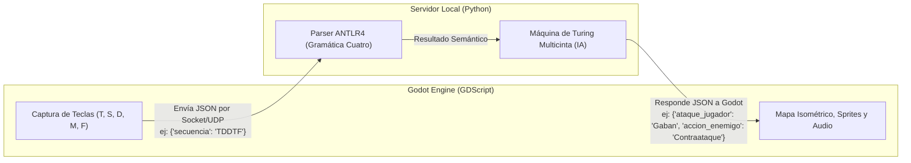
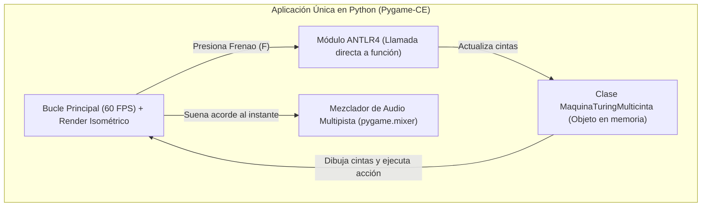

# Comparativa de Arquitectura: Godot (Cliente-Servidor) vs. Pygame (Monolito Python)

Este documento analiza las dos opciones tecnológicas para desarrollar el videojuego 2D isométrico del proyecto final de **Lenguajes de Programación**, evaluando su integración con **ANTLR4** y la **Máquina de Turing Multicinta**.

---

## 1. Resumen de las dos Arquitecturas

### Opción A: Godot Engine + Backend en Python (Cliente-Servidor Local)
Dado que los plugins para incrustar Python dentro de Godot suelen presentar problemas de compatibilidad con librerías externas como `antlr4-python3-runtime`, la forma robusta de usar Godot es separar la parte visual de la lógica formal:

---

### Opción B: Pygame-CE (Monolito 100% en Python)
Todo el videojuego (ventana gráfica, mapa isométrico, sonido, parser de ANTLR y Máquina de Turing) vive dentro de un único proyecto en Python.

---

## 2. Matriz Comparativa

| Criterio | Godot + Python (Cliente-Servidor) | Pygame-CE (Monolito en Python) |
| :--- | :--- | :--- |
| **Integración con ANTLR y Máquina de Turing** | **Media-Compleja:** Requiere programar comunicación por Sockets (TCP/UDP o WebSockets) y serializar datos en JSON en cada acción. | **Directa / Nativa:** Son simples llamadas a funciones y objetos de Python en el mismo código. Cero latencia o problemas de red. |
| **Facilidad para Crear la Vista Isométrica** | **Alta (Visual):** Godot tiene el nodo `TileMapLayer` con soporte visual para grillas isométricas, colisiones y ordenamiento de profundidad (*Y-Sort*). | **Media (Por código o Tiled):** Se diseña el mapa en el programa externo **Tiled** (usando `PyTMX`) o mediante una matriz en Python con conversión matemática $(x, y)$ a isométrico. |
| **Animaciones e Interfaz (UI)** | **Alta:** Editor visual de animaciones (`AnimatedSprite2D`), barras de vida, partículas e iluminación listos para arrastrar y soltar. | **Manual:** Las barras de vida, textos, partículas y hojas de sprites (*spritesheets*) se dibujan mediante código (aunque es fácil de automatizar). |
| **Visualización Académica (Árbol ANTLR y Cintas de Turing)** | **Más trabajosa:** Hay que enviar el estado de las 3 cintas y los cabezales por JSON desde Python hacia Godot para dibujarlos en la UI de Godot. | **Muy fácil:** Como la Máquina de Turing está en el mismo script, se pueden dibujar las 3 cintas y sus cabezales directamente en una esquina de la pantalla en 10 líneas de código. |
| **Depuración (Debugging)** | **Doble consola:** Si algo falla, hay que revisar tanto el debugger de Godot como la terminal de Python por separado. | **Unificada:** Un solo punto de ejecución. Si hay un error en la gramática, en la máquina o en el juego, sale en la misma consola. |
| **Ejecución el día de la sustentación** | Hay que levantar primero el servidor de Python en consola y luego abrir el juego en Godot (o automatizar el arranque con un script). | Se ejecuta un único archivo (`python main.py`) y todo abre de inmediato. |
| **Curva de aprendizaje para el equipo** | Ya cuentan con experiencia previa en Godot, lo que acelera la creación de escenas y personajes. | Muy baja si ya conocen Python, pero requiere acostumbrarse a posicionar elementos por coordenadas en lugar de usar un editor visual. |

---

## 3. Potencia y Capacidades de Pygame-CE para este Proyecto

Una duda común es si Pygame es "suficientemente potente" para un juego de acción isométrico:

1. **Rendimiento Gráfico:** `pygame-ce` utiliza aceleración por **SDL2** (escrito en C). Para un juego 2D isométrico con el llanero, enemigos, proyectiles musicales y efectos visuales, corre fácilmente a **60 FPS constantes** en cualquier computador portátil.
2. **Sistema de Audio Ideal para el Cuatro:** Su módulo `pygame.mixer` permite reproducir una pista de fondo (arpa y maracas) mientras dispara en paralelo hasta 16 o 32 canales de efectos de sonido simultáneos sin retraso (*latencia casi nula* al presionar cada acorde `T`, `S`, `D`, `M`, `F`).
3. **Control del Tiempo Real:** Permite manejar temporizadores precisos en milisegundos para las "ventanas de reacción" cuando el enemigo carga un ataque y el jugador debe responder tocando la secuencia correcta.

---

## 4. Conclusión: ¿Cuál elegir en la reunión de equipo?

### Elijan **Godot + Servidor Python** si:
- Quieren aprovechar al máximo su **experiencia previa en Godot** para que el juego se vea visualmente muy pulido (efectos de luces, cámaras, colisiones complejas, menús animados) sin invertir tiempo programando un motor gráfico desde cero.
- No les molesta dividir el trabajo: una parte del equipo programa el servidor en Python (ANTLR + Máquina de Turing + Socket) y otra parte hace el cliente visual en Godot.

### Elijan **Pygame-CE (Monolito)** si:
- Quieren **cero fricción técnica** conectando ANTLR y la Máquina de Turing con el juego.
- Quieren que el enfoque principal sea la lógica del curso de Lenguajes de Programación (mostrar las cintas de la Máquina de Turing y la gramática en pantalla en tiempo real) manteniendo todo en un único repositorio 100% en Python.
