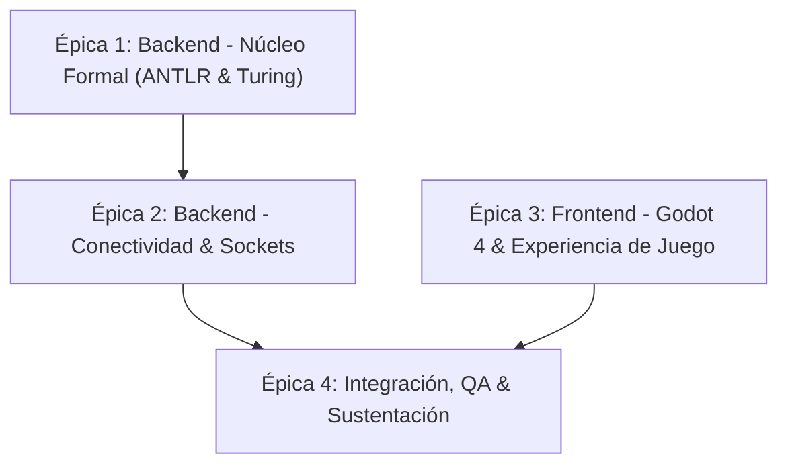

# Planificación del Proyecto y Backlog de Issues

Este documento contiene la planificación completa para el desarrollo del proyecto final de **Lenguajes de Programación**, dividida en **4 Épicas** y **10 Issues accionables** con criterios de aceptación claros.

---

## Estructura de Épicas

---

## Estado Actual de Implementación

| Issue | Título | Estado en GitHub |
| :---: | :--- | :---: |
| #1 | Analizador sintáctico del Cuatro Llanero con ANTLR4 | `CLOSED` |
| #2 | Máquina de Turing Multicinta para la IA del enemigo | `CLOSED` |
| #3 | Controlador de combate simple y resolución de turnos | `CLOSED` |
| #4 | Servidor de Sockets TCP local (`127.0.0.1:8765`) | `CLOSED` |
| #5 | Escenario base en Godot 4 (`CombatArena` Top-Down 2D + TileMaps + 8 dirs) | `CLOSED` |
| #6 | Entrada del jugador y audio inmediato del Cuatro (Fast-Path) | `CLOSED` |
| #7 | Cliente de red (`NetworkClient.gd`) para comunicación con Python | `CLOSED` |
| #8 | HUD visual de combate y visualizador de las Cintas de Turing | `OPEN` |
| #9 | Pruebas de integración de extremo a extremo y casos de borde | `OPEN` |
| #10 | Script de arranque rápido y guía para la sustentación | `OPEN` |

---

## Catálogo de Issues

### Épica 1: Backend - Núcleo Formal (Python)

#### 1. `[Backend] Implementar el analizador sintáctico del Cuatro Llanero con ANTLR4` (`CLOSED`)
- **Etiquetas:** `backend`, `formal-methods`, `p1-high`
- **Descripción:** Crear la gramática libre de contexto en `CuatroLlanero.g4` para validar los 6 golpes del cuatro (`Gabán`, `Pajarillo`, `Seis por Derecho`, `Zumbe y Zumbe`, `Tonada`, y el `Contrapunteo Recursivo`). Compilar la gramática a Python e implementar un `ErrorListener` para detectar cuerdas desafinadas / errores sintácticos.
- **Criterios de Aceptación:**
  - Archivo `CuatroLlanero.g4` creado con tokens `TONICA`, `SUBDOM`, `DOMINANTE`, `MENOR`, `FRENAO`.
  - Código Python generado con `antlr4 -Dlanguage=Python3`.
  - Función `validar_secuencia(cadena)` que retorne el tipo de golpe o reporte `ERROR_SINTACTICO`.

#### 2. `[Backend] Implementar la Máquina de Turing Multicinta para la IA del enemigo` (`CLOSED`)
- **Etiquetas:** `backend`, `formal-methods`, `p1-high`
- **Descripción:** Implementar la clase `MultiTapeTuringMachine` en Python modelando un autómata determinista de 3 cintas. Debe recibir la acción del jugador validada por ANTLR (`A` = Ataque, `D` = Defensa, `C` = Carga/Reducción de furia, `E` = Error), registrarla en la Cinta 1, actualizar el estado de furia/anti-spam en la Cinta 2 y decidir el contraataque en la Cinta 3.
- **Criterios de Aceptación:**
  - Clase `MultiTapeTuringMachine` con 3 cintas dinámicas y cabezales $(L, R, S)$.
  - Función de transición $\delta$ determinista con estados de observación, contraataque y castigo por repetición.
  - Método `step(accion_jugador)` que retorne el estado de las 3 cintas y la decisión del enemigo.

#### 3. `[Backend] Controlador de combate simple y resolución de turnos` (`CLOSED`)
- **Etiquetas:** `backend`, `gameplay`, `p2-medium`
- **Descripción:** Crear el controlador en Python que cruce la acción del llanero con la acción de la Máquina de Turing del enemigo para calcular el daño, la defensa y el estado de la partida.
- **Criterios de Aceptación:**
  - Matriz de resolución: si el jugador usa *Seis por Derecho* o *Zumbe y Zumbe* (`D`) y el enemigo ataca, anula el daño (Parry).
  - Si el jugador comete un error sintáctico (`E`), recibe `0` daño directo e inmovilización de `1.0 s` en Godot; si repite `3` veces seguidas la misma acción válida, recibe daño crítico (`35`, `CASTIGO`).
  - Retorna un diccionario Python listo para ser serializado a JSON.

---

### Épica 2: Backend - Conectividad & Sockets

#### 4. `[Backend] Servidor de Sockets/WebSockets para comunicación local` (`CLOSED`)
- **Etiquetas:** `backend`, `network`, `p1-high`
- **Descripción:** Implementar un servidor TCP ligero en Python (`socketserver.ThreadingTCPServer`) que escuche en `127.0.0.1:8765`, reciba la cadena del cliente Godot delimitada por `\n`, la pase por ANTLR + Turing y devuelva la respuesta JSON.
- **Criterios de Aceptación:**
  - Servidor escuchando en `127.0.0.1:8765`.
  - Procesa peticiones del formato `{"secuencia": "TDDTF"}`.
  - Responde con el resultado del combate y el snapshot de las 3 cintas.

---

### Épica 3: Frontend - Godot Engine 4

#### 5. `[Godot] Estructura base del proyecto y escenario 2D Top-Down` (`CLOSED`)
- **Etiquetas:** `frontend`, `godot`, `p2-medium`
- **Descripción:** Inicializar el proyecto en Godot 4 con su estructura de carpetas (`scenes/`, `scripts/`, `assets/`), configurar la escena Top-Down 2D ortogonal con `TileMapLayer`s (32×32 px), horizonte animado y sprites en 8 direcciones para el Llanero y El Silbón.
- **Criterios de Aceptación:**
  - Proyecto Godot 4 ejecutable con resolución 1280×720 configurada.
  - Escenario Top-Down 2D con `Llanero`, `ElSilbon` y `MuroEspectral` cerrado.

#### 6. `[Godot] Entrada del jugador y sistema de audio inmediato del Cuatro (Fast-Path)` (`CLOSED`)
- **Etiquetas:** `frontend`, `audio`, `p1-high`
- **Descripción:** Capturar las teclas de los acordes (`J` = `T` Tónica, `K` = `S` Subdominante, `L` = `D` Dominante, `I` = `M` Menor, `Espacio` = `F` Frenao, `Backspace` = Limpiar). Cada pulsación debe reproducir el sonido real del cuatro inmediatamente en local y acumular los tokens en un arreglo temporal.
- **Criterios de Aceptación:**
  - Banco de sonidos de los 4 acordes + Frenao (`.wav`).
  - Al presionar una tecla, el sonido se reproduce con latencia nula.
  - Al presionar `Espacio`, se bloquea temporalmente el input y se envía la cadena.

#### 7. `[Godot] Cliente de red para comunicación con el servidor Python` (`CLOSED`)
- **Etiquetas:** `frontend`, `network`, `p1-high`
- **Descripción:** Implementar un script GDScript (`NetworkClient.gd`) que establezca la conexión TCP con el backend de Python, envíe la secuencia acumulada al presionar `Espacio` y emita una señal cuando llegue la respuesta del servidor.
- **Criterios de Aceptación:**
  - Conexión exitosa a `127.0.0.1:8765`.
  - Manejo de reconexión, timeout (`1.5 s`) y mensaje de advertencia si el servidor Python no está encendido.
  - Emite la señal `combate_resuelto(data)` con los datos del servidor.

#### 8. `[Godot] HUD visual de combate y visualizador de las Cintas de Turing` (`OPEN`)
- **Etiquetas:** `frontend`, `ui`, `p1-high`
- **Descripción:** Crear la interfaz de usuario en Godot con las barras de vida de ambos personajes, el visor de acordes tocados y el visualizador gráfico de las 3 cintas de la Máquina de Turing para la sustentación ante la profesora.
- **Criterios de Aceptación:**
  - Barras de vida animadas que se actualizan con la respuesta del servidor.
  - Componente que dibuja las 3 cintas con celdas y resalta la posición de los cabezales.
  - Feedback visual ante error sintáctico (pantalla o cuatro en rojo).

---

### Épica 4: Integración, QA & Sustentación

#### 9. `[QA] Pruebas de integración de extremo a extremo y casos de borde` (`OPEN`)
- **Etiquetas:** `qa`, `integration`, `p2-medium`
- **Descripción:** Ejecutar pruebas de extremo a extremo entre Godot y Python validando los 6 golpes llaneros, combos recursivos de contrapunteo de longitud variable y cadenas inválidas.
- **Criterios de Aceptación:**
  - Matriz de pruebas ejecutada con éxito.
  - Comprobar que los errores sintácticos registran `E` en la Máquina de Turing sin quitar vida (`dano_jugador = 0`) e inmovilizan al jugador durante `1.0 s`, mientras `3` repeticiones consecutivas activan el `CASTIGO` de `35` de daño.

#### 10. `[Docs] Script de arranque rápido y guía para la sustentación` (`OPEN`)
- **Etiquetas:** `documentation`, `p3-low`
- **Descripción:** Crear un script de un solo clic (`iniciar_juego.bat` / `iniciar_juego.sh`) que levante el servidor Python y abra el ejecutable de Godot, junto con una guía de preguntas frecuentes para la sustentación con la profesora.
- **Criterios de Aceptación:**
  - Script que levanta ambos componentes sin configuraciones manuales.
  - Documento resumen con la justificación de la gramática y el autómata.
