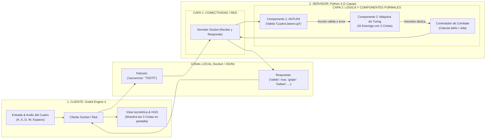

# Arquitectura del Sistema: Cliente-Servidor en Capas

Este documento describe la arquitectura simplificada del proyecto final de **Lenguajes de Programación**, modelada en [Diagrama_Arquitectura.drawio](file:///D:/universidad/treceavo%20semestre/lenguajes/proyecto/Documentacion_tecnica/Diagrama_Arquitectura.drawio).

El objetivo es mantener una estructura **limpia, directa**, enfocada exactamente en los dos requerimientos académicos del curso: **ANTLR4** (para el llanero) y la **Máquina de Turing Multicinta** (para el enemigo).

---

## 1. Visión General de la Arquitectura



---

## 2. Descripción de Componentes

### 1. Cliente: Godot Engine 4 (Interfaz y Juego)
* **Entrada y Audio:** Captura las teclas (`A`, `S`, `D`, `W`, `Espacio`) y reproduce el sonido del acorde inmediatamente en local (cero latencia para que se sienta fluido tocar el cuatro). Acumula la cadena (ej. `TDDTF`).
* **Cliente de Red:** Al presionar `F` (*Frenao*), envía un mensaje simple por socket local:
  ```json
  { "secuencia": "TDDTF" }
  ```
* **Vista y HUD:** Muestra el combate isométrico y dibuja las **3 cintas de la Máquina de Turing** en la pantalla para evidenciar su funcionamiento ante la profesora.

---

### 2. Servidor: Python 3 (Arquitectura de 2 Capas)

#### **Capa 1: Capa de Conectividad / Red**
* **Servidor Socket:** Un script en Python que escucha peticiones locales (`localhost`).
* Recibe el JSON con la secuencia del llanero, lo pasa a la capa de lógica, y devuelve el resultado a Godot.

#### **Capa 2: Capa de Lógica y Componentes Formales**
* **Componente 1: Parser ANTLR4 (`CuatroLlanero.g4`)**
  * Valida la secuencia musical.
  * Si la cadena es correcta, identifica qué golpe es (*Gabán*, *Pajarillo*, *Seis*, etc.).
  * Si la cadena no pertenece a la gramática, reporta **Error Sintáctico (Desafinado)**.
* **Componente 2: Máquina de Turing Multicinta (IA Enemiga)**
  * Recibe el resultado de ANTLR:
    * **Cinta 1:** Guarda el historial de acciones (`A` = Ataque, `D` = Defensa, `C` = Curación, `E` = Error).
    * **Cinta 2:** Furia del enemigo y detector de spam (si el jugador repite mucho la misma canción).
    * **Cinta 3:** Escribe la decisión táctica del enemigo (*Ataque Rápido*, *Ataque Pesado*, *Bloqueo*, *Castigo*).
* **Controlador de Combate:**
  * Cruza la acción del llanero con la del enemigo (aplica parry, daño o curación) y arma la respuesta JSON final para Godot:
  ```json
  {
    "valido": true,
    "golpe": "Golpe de Gaban",
    "dano_jugador": 25,
    "enemigo_accion": "Contraataque",
    "cintas": {
      "cinta1": ["A", "D", "A"],
      "cinta2": ["1", "1"],
      "cinta3": ["R", "B", "R"]
    }
  }
  ```
