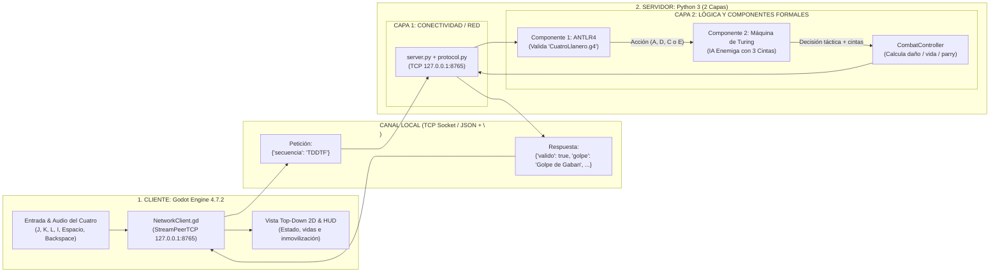

# Arquitectura del Sistema: Cliente-Servidor en Capas

Este documento describe la arquitectura del proyecto final de **Lenguajes de Programación**, modelada en [Diagrama_Arquitectura.drawio](./Diagrama_Arquitectura.drawio).

El objetivo es mantener una estructura **limpia, directa**, enfocada exactamente en los dos requerimientos académicos del curso: **ANTLR4** (para el cuatro del llanero) y la **Máquina de Turing Multicinta** (para el enemigo *El Silbón*).

---

## 1. Visión General de la Arquitectura



---

## 2. Descripción de Componentes

### 1. Cliente: Godot Engine 4.7.2 (Interfaz y Juego)
* **Movimiento:** El Llanero se mueve en 8 direcciones con `WASD` o Flechas (`Llanero.gd`), mientras *El Silbón* patrulla y acecha en 8 direcciones (`ElSilbon.gd`).
* **Entrada y Audio (Fast-Path):** `CuatroController.gd` captura las teclas **`J`** (`T`), **`K`** (`S`), **`L`** (`D`), **`I`** (`M`), **`Espacio`** (`F` - Frenao) y **`Backspace`** (limpiar), reproduciendo el sonido real del acorde al instante en local y acumulando la cadena (ej. `TDDTF`).
* **Cliente de Red:** `NetworkClient.gd` mantiene conexión TCP local con `127.0.0.1:8765` (con timeout de `1.5 s` y aviso si el servidor está apagado). Al presionar `Espacio` (*Frenao*), envía:
  ```json
  { "secuencia": "TDDTF" }
  ```
* **Vista y HUD:** Muestra la arena Top-Down 2D (`CombatArena.tscn`) y actualiza el estado del turno (`UI/LabelEstado`), la vida del jugador y la inmovilización de `1.0 s` cuando la secuencia es inválida. *(La visualización gráfica completa de las 3 cintas en el HUD de Godot corresponde a la Issue #8 abierta; mientras tanto las 3 cintas viajan en cada JSON y se imprimen en la consola de Python.)*

---

### 2. Servidor: Python 3 (Arquitectura de 2 Capas)

#### **Capa 1: Capa de Conectividad / Red**
* **`backend/network/server.py` y `protocol.py`:** Servidor TCP multi-hilo en `127.0.0.1:8765` que lee líneas UTF-8 delimitadas por `\n`, valida el JSON y devuelve la respuesta serializada.

#### **Capa 2: Capa de Lógica y Componentes Formales**
* **Componente 1: Parser ANTLR4 (`backend/formal/grammar/CuatroLlanero.g4`)**
  * Valida la secuencia musical.
  * Si la cadena es correcta, identifica qué golpe es (*Golpe de Gabán*, *Golpe de Pajarillo*, *Seis por Derecho*, *Zumbe y Zumbe*, *Tonada de Sabana*, *Contrapunteo Libre*).
  * Si la cadena no pertenece a la gramática, reporta **`ERROR_SINTACTICO` (`E`)**.
* **Componente 2: Máquina de Turing Multicinta (`backend/formal/turing/turing.py`)**
  * Recibe el resultado de ANTLR (`A`, `D`, `C` o `E`):
    * **Cinta 1 (cabezal `L`):** Historial de acciones del jugador (`["A", "D", "E", ...]`).
    * **Cinta 2 (cabezal `R = 0`):** Memoria `[furia, repeticion]` (valores de `"0"` a `"3"`).
    * **Cinta 3 (cabezal `S`):** Historial de decisiones tácticas del enemigo (`ATAQUE_RAPIDO`, `ATAQUE_PESADO`, `BLOQUEO`, `CASTIGO`).
* **Controlador de Combate (`backend/game/combat.py`):**
  * Calcula vidas, parry y daños del turno (`dano_jugador = 0` si es error sintáctico `E`, inmovilizando en Godot `1.0 s`; `35` de daño si se repite 3 veces seguidas la misma acción) y arma la respuesta JSON para Godot:
  ```json
  {
    "valido": true,
    "golpe": "Golpe de Gaban",
    "accion": "A",
    "error": null,
    "dano_enemigo": 15,
    "dano_jugador": 10,
    "enemigo_accion": "ATAQUE_RAPIDO",
    "vida_jugador": 90,
    "vida_enemigo": 85,
    "estado": "JUGANDO",
    "cintas": {
      "cinta1": ["A"],
      "cinta2": ["1", "1"],
      "cinta3": ["ATAQUE_RAPIDO"]
    },
    "cabezales": {
      "L": 0,
      "R": 0,
      "S": 0
    }
  }
  ```
