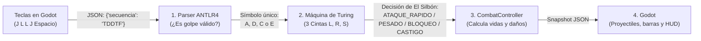
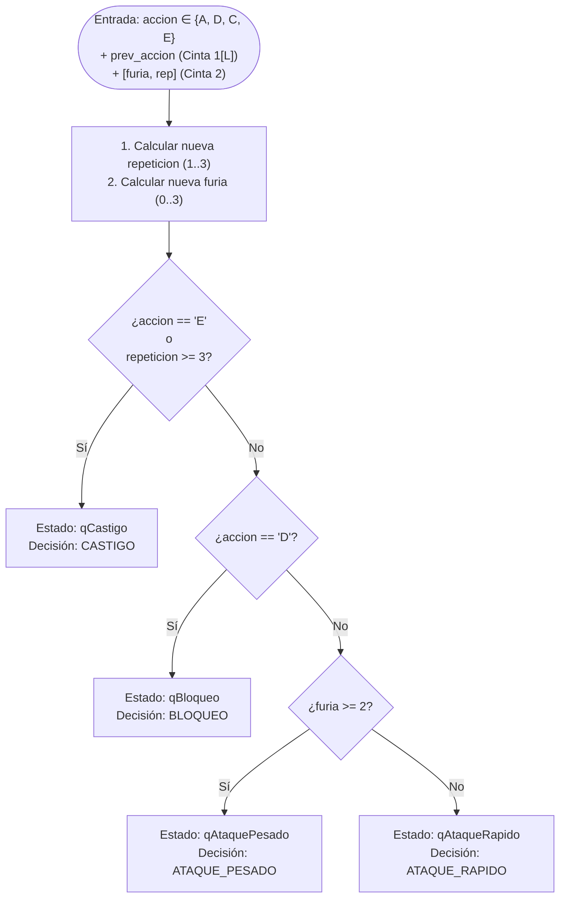

# Guía Paso a Paso: Cómo Funciona la Máquina de Turing del Juego

Esta guía explica de forma sencilla y exacta cómo funciona la **Máquina de Turing Multicinta** implementada en el proyecto, para qué sirve dentro del juego y cómo se relaciona con **ANTLR4**, **Python**, **Godot** y los archivos de **JFLAP** (`.jff`).

---

## 1. La idea central: ¿Qué hace ANTLR y qué hace la Máquina de Turing?

Un error común al revisar el proyecto es pensar que la Máquina de Turing lee acordes (`T`, `S`, `D`, `M`, `F`). **En el juego real no funciona así**, sino en dos pasos separados:

1. **Primero actúa ANTLR4 (`CuatroLlanero.g4` + `parser.py`):**
   - Lee la secuencia de acordes que tocaste con el cuatro (por ejemplo `"TDDTF"`).
   - Comprueba si es un golpe válido y lo **resume en un solo símbolo** (`accion`):
     - **`A`** = Ataque (*Gabán*, *Pajarillo*, *Contrapunteo Libre*)
     - **`D`** = Defensa (*Seis por Derecho*, *Zumbe y Zumbe*)
     - **`C`** = Carga / Utilidad (*Tonada de Sabana*)
     - **`E`** = Error sintáctico (cuerda desafinada / secuencia inválida)

2. **Después actúa la Máquina de Turing (`backend/formal/turing/turing.py`):**
   - Recibe **esa única letra** (`A`, `D`, `C` o `E`) como entrada del turno.
   - Consulta su memoria interna (las **3 cintas**) y decide de forma **100% determinista** (sin `random`) qué hará **El Silbón** en este turno.



---

## 2. Anatomía de las 3 Cintas y los 3 Cabezales (`L`, `R`, `S`)

La clase `MultiTapeTuringMachine` en [`turing.py`](../../backend/formal/turing/turing.py) simula una máquina determinista con **3 cintas** independientes y **3 cabezales**:

| Cinta | Nombre conceptual | Cabezal | Qué guarda | Estado inicial |
| :--- | :--- | :---: | :--- | :--- |
| **Cinta 1** | Historial del jugador | `L` | Cada acción ejecutada turno a turno: `["A", "A", "D", ...]` | Vacía `[]`, `L = 0` |
| **Cinta 2** | Memoria interna de IA | `R` | Dos celdas fijas: **`[furia, repeticion]`** (valores de `"0"` a `"3"`) | `["0", "0"]`, `R = 0` |
| **Cinta 3** | Historial del enemigo | `S` | Cada decisión que tomó El Silbón: `["ATAQUE_RAPIDO", ...]` | Vacía `[]`, `S = 0` |

### ¿Para qué sirve cada celda de la Cinta 2?
- **Celda `0` (`furia`, de `0` a `3`):** Mide qué tan alterado está El Silbón:
  - Si atacas (**`A`**): sube **`+1`**.
  - Si defiendes (**`D`**) o tocas *Tonada* (**`C`**): baja **`-1`**.
  - Si yerras la gramática (**`E`**): sube **`+2`**.
  - Siempre se mantiene acotada entre `0` y `3` (`max(0, min(..., 3))`).
- **Celda `1` (`repeticion`, de `1` a `3`):** Es el **detector anti-spam**:
  - Cuenta cuántas veces seguidas repetiste exactamente la **misma acción** (`A`, `D`, `C` o `E`) comparándola con la celda donde quedó el cabezal `L` en la Cinta 1.
  - Si cambias de acción, vuelve a **`1`**. Si repites la misma, sube `+1` (tope `3`).

> [!NOTE]
> En la traza que imprime Python en consola verás `mov=(R, R->L, R)` en la Cinta 2: significa que el cabezal `R` está en `0` (`furia`), lee la celda `1` (`repeticion`) y vuelve a quedar posicionado en `0` (`R = 0`). En el primer turno `mov` en Cintas 1 y 3 es `S` (*Stay*) porque escriben en la celda `0`, y desde el segundo turno avanzan con `R` (*Right*).

---

## 3. Estados y Reglas de Transición ($\delta$)

Al iniciar la partida, la máquina arranca en el estado inicial **`qObservacion`** (en el archivo JFLAP se llama **`qInicio`**). En cada turno evalúa la función `_transicion_delta(...)` siguiendo **este orden estricto de prioridad**:



### Tabla de decisiones y efectos reales en combate ([`combat.py`](../../backend/game/combat.py))

| Estado final | Decisión (Cinta 3) | Cuándo se activa | Efecto real en el Llanero |
| :--- | :--- | :--- | :--- |
| **`qAtaqueRapido`** | `ATAQUE_RAPIDO` | Jugaste `A` o `C` sin spam (`rep < 3`) y la furia resultante quedó en `0` o `1`. | Proyectil rápido de **`10` de daño**. |
| **`qAtaquePesado`** | `ATAQUE_PESADO` | Jugaste `A` o `C` sin spam (`rep < 3`) y la furia resultante subió a `2` o `3`. | Proyectil pesado de **`20` de daño**. |
| **`qBloqueo`** | `BLOQUEO` | Jugaste una defensa (`D`: *Seis por Derecho* o *Zumbe y Zumbe*) con `rep < 3`. | **`0` de daño** (El Silbón levanta aura violeta defensiva). |
| **`qCastigo`** | `CASTIGO` | **Caso 1 (Spam):** repetiste **3 veces seguidas** la misma acción (`repeticion >= 3`).<br>**Caso 2 (Error `E`):** tocaste una secuencia inválida en ANTLR. | **Caso 1 (`A`/`C` x3):** **`35` de daño** crítico.<br>*(Si repetiste `D` x3, el parry de `D` aún anula el daño = `0`.)*<br>**Caso 2 (`E`):** **`0` de daño** en HP + furia `+2` + **inmovilizado `1.0 s`** en Godot. |

---

## 4. Traza paso a paso de una partida de ejemplo

Supongamos que vas jugando los siguientes turnos desde el inicio (`estado = qObservacion`, `cinta1 = []`, `cinta2 = ["0", "0"]`, `cinta3 = []`):

| Turno | Secuencia tocada | Salida ANTLR | `prev_accion` | Nueva `furia` | Nueva `rep` | Estado / Decisión de Turing | Cintas después del turno (`[...]` = cabezal) | Daño al jugador |
| :---: | :--- | :---: | :---: | :---: | :---: | :--- | :--- | :---: |
| **1** | `TDDTF` (*Gabán*) | **`A`** | `""` | `0 + 1 = 1` | **`1`** | **`qAtaqueRapido`** (`furia < 2`) | C1: `[A]`<br>C2: `[1] 1`<br>C3: `[ATAQUE_RAPIDO]` | **`10` HP** |
| **2** | `MSDMF` (*Pajarillo*) | **`A`** | `"A"` | `1 + 1 = 2` | **`2`** | **`qAtaquePesado`** (`furia >= 2`) | C1: `A [A]`<br>C2: `[2] 2`<br>C3: `ATAQUE_RAPIDO [ATAQUE_PESADO]` | **`20` HP** |
| **3** | `TDSDTF` (*Contrapunteo*) | **`A`** | `"A"` | `2 + 1 = 3` | **`3`** | **`qCastigo`** (`rep >= 3`, ¡spam!) | C1: `A A [A]`<br>C2: `[3] 3`<br>C3: `... [CASTIGO]` | **`35` HP** |
| **4** | `TSDTF` (*Seis por Derecho*) | **`D`** | `"A"` | `3 - 1 = 2` | **`1`** | **`qBloqueo`** (`accion == D`) | C1: `A A A [D]`<br>C2: `[2] 1`<br>C3: `... [BLOQUEO]` | **`0` HP** *(Parry)* |
| **5** | `TMSTF` (*Tonada*) | **`C`** | `"D"` | `2 - 1 = 1` | **`1`** | **`qAtaqueRapido`** (`furia` bajó a `1`) | C1: `A A A D [C]`<br>C2: `[1] 1`<br>C3: `... [ATAQUE_RAPIDO]` | **`10` HP** |
| **6** | `TTDF` *(inválida)* | **`E`** | `"C"` | `1 + 2 = 3` | **`1`** | **`qCastigo`** (`accion == E`) | C1: `A A A D C [E]`<br>C2: `[3] 1`<br>C3: `... [CASTIGO]` | **`0` HP** + **1s inmóvil** |

Fíjate en la estrategia que crea la máquina:
- Si solo spameas ataques (`A`, `A`, `A`), al 2.º turno ya te pega fuerte (`20`) y al 3.º te castiga con **`35`**.
- Para evitar el `CASTIGO` y bajarle la furia, tienes que **alternar** golpes de ataque (`A`), defensas (`D`) y *Tonada de Sabana* (`C`).

---

## 5. ¿Por qué hay 3 archivos `.jff` distintos en el repositorio?

Aquí suele haber confusión al abrir JFLAP. Solo **uno** representa la Máquina de Turing conectada al servidor Python actual:

| Archivo | Cintas | Qué es | ¿Lo usa el código actual? |
| :--- | :---: | :--- | :--- |
| [`backend/formal/turing/maquina_turing_enemigo.jff`](../../backend/formal/turing/maquina_turing_enemigo.jff) | **3 cintas** | **Modelo JFLAP oficial del backend.** Implementa exactamente las transiciones de furia (`0..3`) y decisión (`R/P/B/C`) para un turno de [`turing.py`](../../backend/formal/turing/turing.py). | **Sí** (es su equivalente en JFLAP) |
| [`Documentacion/MaquinaTuring/maquina_cuatro.jff`](../MaquinaTuring/maquina_cuatro.jff) | 1 cinta | Prototipo temprano para reconocer cadenas `T, S, D, M, F`. | No (hoy esa validación la hace **ANTLR4**) |
| [`Documentacion/MaquinaTuring/maquina_juego_multicinta.jff`](../MaquinaTuring/maquina_juego_multicinta.jff) | 5 cintas | Boceto inicial de diseño antes de definir el protocolo con Godot. | No (prototipo histórico) |

### Cómo probar el `.jff` oficial en JFLAP
1. Abre [`backend/formal/turing/maquina_turing_enemigo.jff`](../../backend/formal/turing/maquina_turing_enemigo.jff) en JFLAP y selecciona **Input → Multiple Run**.
2. Ingresa 3 cintas:
   - **Cinta 1:** una acción (`A`, `D`, `C` o `E`).
   - **Cinta 2:** la furia actual (`0`, `1`, `2` o `3`).
   - **Cinta 3:** déjala **vacía**.
3. Como JFLAP solo permite **1 carácter por celda**, escribe la decisión con una letra:
   - **`R`** = `ATAQUE_RAPIDO`
   - **`P`** = `ATAQUE_PESADO`
   - **`B`** = `BLOQUEO`
   - **`C`** = `CASTIGO`

*(Nota importante: JFLAP simula un turno aislado porque reinicia las cintas en cada ejecución; en Python `MultiTapeTuringMachine` conserva además el historial de las cintas y el contador `repeticion` entre un turno y otro.)*

---

## 6. Cómo ver las 3 cintas en vivo mientras juegas

Al ejecutar el servidor en tu terminal con:

```powershell
py -m backend.main
```

Cada vez que envíes una secuencia desde Godot, Python imprime en esa misma consola el estado exacto de la máquina (el método `format_trace()` de [`turing.py`](../../backend/formal/turing/turing.py)), por ejemplo:

```text
=== Máquina de Turing Multicinta ===
Estado actual: qAtaquePesado
Transición   : δ(qAtaqueRapido, (A, 1|1, _), in='A') -> (qAtaquePesado, (A, 2|2, ATAQUE_PESADO), mov=(R, R->L, R))
Cinta 1 [cab L=1]: A [A]
Cinta 2 [cab R=0]: [2] 2
Cinta 3 [cab S=1]: ATAQUE_RAPIDO [ATAQUE_PESADO]
====================================
```

Los corchetes **`[...]`** indican exactamente la celda donde está parado cada cabezal (`L`, `R` y `S`) después de ejecutar el turno.
