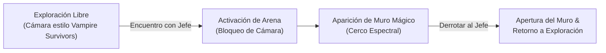

# Diseño de Mecánica: Arena de Combate contra Jefes y Muro Espectral

Este documento describe la mecánica de transición entre la exploración del mundo y el enfrentamiento contra jefes míticos (ej. *El Silbón*, *La Sayona*), así como el confinamiento del combate en la escena `CombatArena`.

---

## 1. Contexto de Exploración vs. Combate



1. **Modo Exploración (Estilo *Vampire Survivors*):**
   - El llanero se desplaza libremente por la sabana llanera con una cámara que lo sigue suavemente.
2. **Modo Encuentro con Jefe (*Boss Fight Arena*):**
   - Al entrar en el radio de detección de un jefe mítico, se dispara el evento de combate.
   - **Bloqueo de Cámara (*Camera Lock-in*):** La cámara se desacopla del seguimiento libre del jugador y se fija en el centro del terreno de combate delimitado, mostrando tanto al llanero como al jefe en pantalla en todo momento.

---

## 2. El Muro Mágico / Cerco Espectral

Para dar coherencia narrativa y justificar por qué el jugador no puede simplemente huir del combate, se manifiesta una barrera mística del folclore llanero (niebla de espantos, cerco de fuego fatuo o silbidos espectrales).

### Reglas y Comportamiento del Muro:

| Propiedad | Comportamiento en Juego | Justificación de Diseño |
| :--- | :--- | :--- |
| **Barrera Infranqueable** | No permite que el llanero ni el enemigo atraviesen el límite del escenario. | Evita que el combate se desplace fuera del alcance de la cámara fija y del HUD. |
| **Daño por Contacto** | Si el jugador toca el borde del muro mágico, recibe **daño por segundo continuo** (ej. 5 de daño por tick) o sufre un **empuje hacia el centro (*Knockback*)**. | Evita la táctica de quedarse "campeando" en los bordes de la pantalla. Obliga al jugador a mantenerse en el centro de la arena mientras ejecuta las secuencias del cuatro. |
| **Visuales y Audio** | Partículas de fuego fatuo / niebla morada en el perímetro y un zumbido místico cuando el jugador se aproxima. | Telegrafía claramente el peligro de acercarse al borde. |

---

## 3. Condiciones de Desactivación

El confinamiento de la arena termina bajo dos únicas condiciones:

1. **Victoria:** La Máquina de Turing en el servidor registra que la vida del jefe llegó a `0`. El muro mágico se disuelve con una animación de luz, la cámara vuelve a seguir al llanero libremente y se desbloquea el avance en el mapa.
2. **Derrota:** La vida del llanero llega a `0`. Se activa la pantalla de reintento (*Game Over* / Reaparición en el último hato o fogón).

---

## 4. Guía de Implementación Técnica en Godot 4 (`CombatArena.tscn`)

1. **Límites de Cámara:**
   - En el nodo `Camera2D`, configurar los límites (`limit_left`, `limit_top`, `limit_right`, `limit_bottom`) coincidentes con el tamaño de la arena (ej. 1280x720).
2. **Perímetro de Daño (`MuroMagicoArea2D`):**
   - Un nodo `Area2D` con 4 colisiones rectangulares (`CollisionShape2D`) en los cuatro bordes de la pantalla.
   - Script conectado a la señal `body_entered(body)`:
     ```gdscript
     func _on_muro_magico_body_entered(body: Node2D) -> void:
         if body.is_in_group("player"):
             body.recibir_dano(5, "quema_espectral")
             body.aplicar_empuje_hacia_centro()
     ```
3. **Efecto Visual:**
   - Un `GPUParticles2D` o un shader de distorsión en los bordes que se enciende cuando la variable `jefe_activo == true`.
