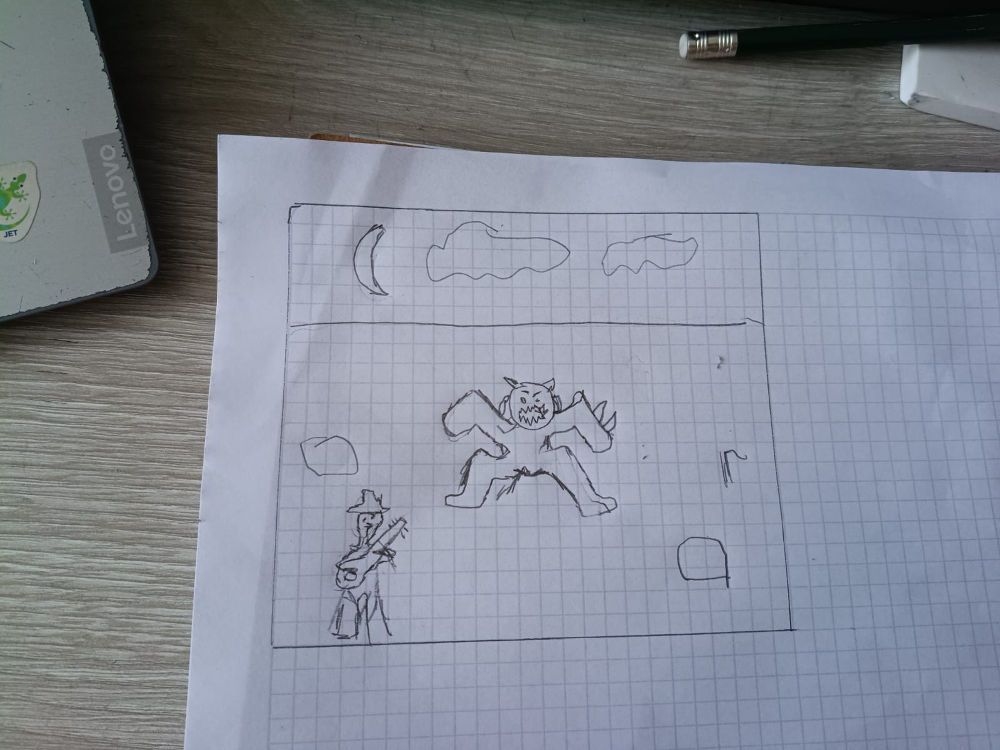
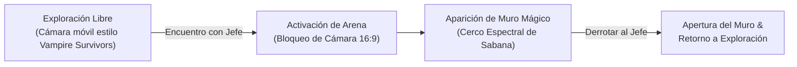

# Diseño de Mecánica: Arena de Combate contra Jefes (Vista Top-Down 2D)

Este documento define la estructura visual, la cámara y el confinamiento del combate en la escena `CombatArena`, basado en el diseño conceptual del juego.

---

## 1. Boceto Conceptual de la Escena de Combate

A continuación se muestra el boceto original de la distribución del escenario y la cámara:

### Elementos clave identificados en el boceto:

1. **Perspectiva Top-Down 2D (No isométrica):**
   - Vista superior ortogonal (estilo *Vampire Survivors* / *Enter the Gungeon*).
   - Los personajes y obstáculos se dibujan de frente/perfil en baldosas cuadradas (sin rombos ni ángulos diagonales complejos), lo que simplifica enormemente la animación en Aseprite.
2. **Franja Superior de Ambientación (Cielo Llanero):**
   - En la parte superior de la pantalla se observa el horizonte nocturno con la **luna y nubes de sabana**, aportando atmósfera de leyenda y misterio.
3. **El Ruedo de Combate (Terreno Delimitado):**
   - Un área rectangular amplia donde el **Llanero con su cuatro** (abajo a la izquierda) y el **Jefe/Espanto** (en el centro) tienen espacio para maniobrar y enfrentarse.
   - Obstáculos naturales en el terreno (rocas/matas de sabana) que sirven de cobertura o limitan el paso.

---

## 2. Transición: Exploración vs. Combate contra el Jefe

1. **Modo Exploración Libre:**
   - El llanero camina en 8 direcciones por la sabana infinita; la cámara lo sigue suavemente.
2. **Modo Arena de Combate (*Camera Lock-in*):**
   - Al encontrar al jefe (ej. *El Silbón*, *El Espanto*), la cámara se ancla al rectángulo de combate (1280×720).
   - Se levanta el **Muro Mágico / Cerco Espectral** en el perímetro.

---

## 3. El Muro Mágico / Cerco Espectral

El borde del rectángulo actúa como una barrera mística del folclore llanero:

| Propiedad | Comportamiento en Juego |
| :--- | :--- |
| **Colisión Infranqueable** | El `MuroEspectral` rodea los 4 bordes de la arena rectangular (`ARENA_RECT` de `96, 250` a `1184, 642`) e impide escapar del ruedo. |
| **Penalización por Contacto** | Si el llanero cruza el límite interior (`ARENA_RECT`), recibe `5` de daño y un empuje (*knockback*) hacia el centro (`aplicar_rebote_muro`), obligándolo a permanecer dentro del ruedo. |
| **Desactivación (Planeado)** | En la progresión completa, al quedar la vida del jefe en `0` se abriría el muro para volver a la exploración libre. |

---

## 4. Estructura actual de la Escena en Godot 4 (`CombatArena.tscn`)

En vista Top-Down 2D ortogonal (1280×720, baldosas de 32×32 px), la escena [CombatArena.tscn](../../cliente_Godot/scenes/combat/CombatArena.tscn) se compone actualmente de:

* **`HorizonteLlanura` (`CanvasLayer` + `HorizonteLlanura.gd`):** Franja superior fija con `CieloFondo`, `NubesA` / `NubesB` desplazándose horizontalmente, `LunaLlanera` con oscilación sutil y `ArbolesHorizonte` (`Saman1`..`Saman6`) animados con el shader `viento_arboles.gdshader`.
* **`TileMapLayer`s (Ortogonal 2D, 32×32 px):** `SueloSabana`, `DecoracionSabana`, `ObstaculosSabana` y `MuroEspectral` (cercado cerrado en sus 4 lados).
* **`Llanero` (`CharacterBody2D` + `Llanero.gd`):** Movimiento y animaciones en **8 direcciones** con `WASD` / Flechas (`walk_*` e `idle_*`). Si comete un error gramatical queda inmovilizado durante `1.0 s`.
* **`ElSilbon` (`CharacterBody2D` + `ElSilbon.gd`):** Patrulla y acecho en **8 direcciones** dentro de la arena.
* **`Luciernagas` (`CPUParticles2D`), `MusicaAmbiente` (`AudioStreamPlayer`), `CuatroController`, `NetworkClient` y `UI/LabelEstado`:** Controlan ambiente, entrada de acordes (`J, K, L, I + Espacio`, `Backspace`), comunicación TCP con Python (`127.0.0.1:8765`) y retroalimentación de combate.
