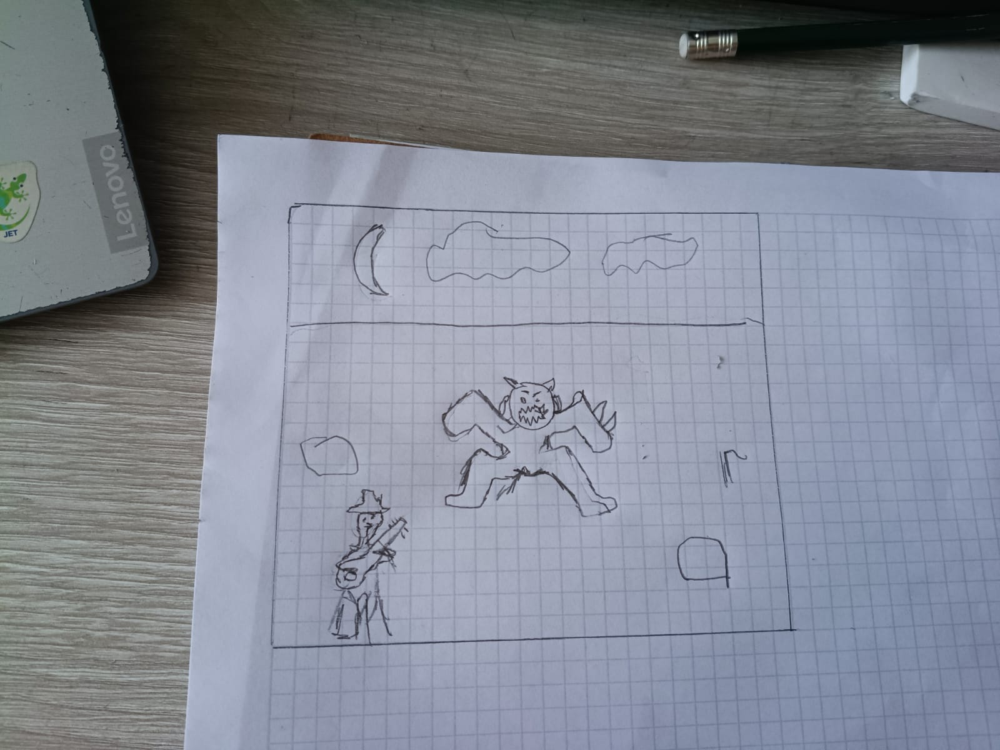
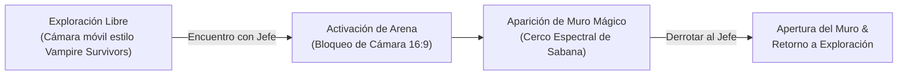

# Diseño de Mecánica: Arena de Combate contra Jefes (Vista Top-Down 2D)

Este documento define la estructura visual, la cámara y el confinamiento del combate en la escena `CombatArena`, basado en el diseño conceptual del juego.

---

## 1. Boceto Conceptual de la Escena de Combate

A continuación se muestra el boceto original de la distribución del escenario y la cámara:

### Elementos clave identificados en el boceto:

1. **Perspectiva Top-Down 2D (No isométrica):**
   - Vista superior ortogonal (estilo *Vampire Survivors* / *Enter the Gungeon*).
   - Los personajes y obstáculos se dibujan de frente/perfil en baldosas cuadradas (sin rombos ni ángulos diagonales complejos), lo que simplifica enormemente la animación en Aseprite.
2. **Franja Superior de Ambientación (Cielo Llanero):**
   - En la parte superior de la pantalla se observa el horizonte nocturno con la **luna y nubes de sabana**, aportando atmósfera de leyenda y misterio.
3. **El Ruedo de Combate (Terreno Delimitado):**
   - Un área rectangular amplia donde el **Llanero con su cuatro** (abajo a la izquierda) y el **Jefe/Espanto** (en el centro) tienen espacio para maniobrar y enfrentarse.
   - Obstáculos naturales en el terreno (rocas/matas de sabana) que sirven de cobertura o limitan el paso.

---

## 2. Transición: Exploración vs. Combate contra el Jefe

1. **Modo Exploración Libre:**
   - El llanero camina en 4 u 8 direcciones por la sabana infinita; la cámara lo sigue suavemente.
2. **Modo Arena de Combate (*Camera Lock-in*):**
   - Al encontrar al jefe (ej. *El Silbón*, *El Espanto*), la cámara se ancla al rectángulo de combate (1280×720).
   - Se levanta el **Muro Mágico / Cerco Espectral** en el perímetro.

---

## 3. El Muro Mágico / Cerco Espectral

El borde del rectángulo actúa como una barrera mística del folclore llanero:

| Propiedad | Comportamiento en Juego |
| :--- | :--- |
| **Colisión Infranqueable** | No permite salir de la arena mientras el jefe esté vivo. |
| **Penalización por Contacto** | Si el llanero toca el borde del muro, recibe daño por segundo y sufre un empuje (*knockback*) hacia el centro, obligándolo a mantenerse en el ruedo tocando el cuatro. |
| **Desactivación** | Cuando la Máquina de Turing en el servidor determine la victoria (vida del jefe en `0`), el muro desaparece y la cámara vuelve a seguir al llanero libremente. |

---

## 4. Estructura de la Escena en Godot 4 (`CombatArena.tscn`)

Con la vista Top-Down 2D, la escena se compone de:

* **`FondoCielo`:** Textura fija en la parte superior con la noche y la luna.
* **`TileMapLayer` (Ortogonal 2D):** Baldosas cuadradas planas (32×32 px) de pasto seco, tierra y camino de sabana.
* **`Obstaculos`:** Rocas y vegetación con colisión (`StaticBody2D`).
* **`Llanero` (`CharacterBody2D`):** Movimiento en 4 direcciones con `W, A, S, D` y ejecución de acordes con `J, K, L, I + Espacio`.
* **`JefeEspanto` (`CharacterBody2D`):** Posicionado en el centro, controlado por las decisiones de la Máquina de Turing.
* **`MuroMagicoArea2D`:** Borde rectangular con detector de colisión que inflige daño al contacto.
