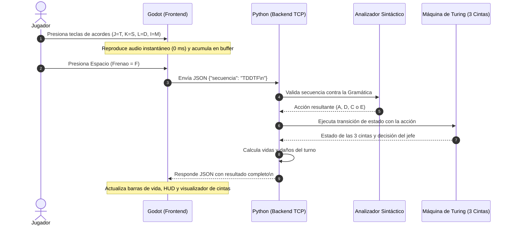

# Protocolo de Comunicación: Godot (Cliente) y Python (Servidor)

Este documento describe la especificación de comunicación mediante **Sockets TCP** locales entre el cliente visual en Godot 4 y el servidor lógico en Python 3.

---

## 1. Parámetros de Conexión

| Parámetro | Valor | Descripción |
|---|---|---|
| **Host** | `127.0.0.1` (localhost) | Comunicación interna en la misma máquina |
| **Puerto** | `8765` | Puerto TCP dedicado al bucle de juego |
| **Transporte** | Socket TCP Stream | Sin cabeceras HTTP, sin latencia de red externa |
| **Delimitador** | Salto de línea (`\n`) | Cada mensaje JSON se envía como una sola línea terminada en `\n` |
| **Codificación** | UTF-8 | Permite tildes y caracteres estándar |

---

## 2. Flujo del Bucle de Combate (Game Loop)



---

## 3. Mensaje de Petición (Request: Godot $\to$ Python)

Cuando el jugador presiona la tecla de Frenao (`Espacio` = token `F`), Godot bloquea temporalmente el input y envía un objeto JSON con la secuencia acumulada:

### Formato:
```json
{
  "secuencia": "TDDTF"
}
```

### Reglas:
* `secuencia`: Cadena de texto obligatoria compuesta por los símbolos del alfabeto del cuatro:
  - `T`: Tónica (Re mayor)
  - `S`: Subdominante (Sol mayor)
  - `D`: Dominante (La séptima)
  - `M`: Menor (Si menor)
  - `F`: Frenao (cierre de compás)
* Se permiten espacios en blanco intermedios (ej: `"T D D T F"`).

---

## 4. Mensaje de Respuesta (Response: Python $\to$ Godot)

El servidor procesa el turno y devuelve inmediatamente una sola línea JSON con el snapshot completo del combate:

### Ejemplo A: Golpe válido (*Gabán*)
```json
{
  "valido": true,
  "golpe": "Golpe de Gaban",
  "accion": "A",
  "error": null,
  "dano_enemigo": 15,
  "dano_jugador": 10,
  "enemigo_accion": "ATAQUE_RAPIDO",
  "vida_jugador": 90,
  "vida_enemigo": 85,
  "estado": "JUGANDO",
  "cintas": {
    "cinta1": ["A"],
    "cinta2": ["1", "1"],
    "cinta3": ["ATAQUE_RAPIDO"]
  },
  "cabezales": {
    "L": 0,
    "R": 0,
    "S": 0
  }
}
```

### Ejemplo B: Error sintáctico (Secuencia inválida / Cuerda desafinada)
```json
{
  "valido": false,
  "golpe": null,
  "accion": "E",
  "error": "La secuencia no pertenece a la gramatica",
  "dano_enemigo": 0,
  "dano_jugador": 35,
  "enemigo_accion": "CASTIGO",
  "vida_jugador": 65,
  "vida_enemigo": 100,
  "estado": "JUGANDO",
  "cintas": {
    "cinta1": ["E"],
    "cinta2": ["2", "1"],
    "cinta3": ["CASTIGO"]
  },
  "cabezales": {
    "L": 0,
    "R": 0,
    "S": 0
  }
}
```

---

## 5. Diccionario de Campos de la Respuesta

| Campo | Tipo | Valores posibles | Descripción |
|---|---|---|---|
| `valido` | `bool` | `true`, `false` | Indica si la secuencia pertenece a la gramática del cuatro |
| `golpe` | `string` o `null` | `"Golpe de Gaban"`, `"Golpe de Pajarillo"`, `"Seis por Derecho"`, `"Zumbe y Zumbe"`, `"Tonada de Sabana"`, `"Contrapunteo Libre"` | Nombre del golpe musical reconocido |
| `accion` | `string` | `"A"` (Ataque), `"D"` (Defensa), `"C"` (Curación), `"E"` (Error) | Clasificación de la acción que ingresa a la Máquina de Turing |
| `error` | `string` o `null` | Mensaje descriptivo o `null` | Detalle del error si `valido` es `false` |
| `dano_enemigo` | `int` | $\ge 0$ | Puntos de vida que pierde el enemigo este turno |
| `dano_jugador` | `int` | $\ge 0$ | Puntos de vida que pierde el jugador este turno (0 si usó Defensa exitosa) |
| `enemigo_accion`| `string` | `"ATAQUE_RAPIDO"`, `"ATAQUE_PESADO"`, `"BLOQUEO"`, `"CASTIGO"` | Decisión táctica tomada por la Máquina de Turing del jefe |
| `vida_jugador` | `int` | `0` a `100` | Vida actual restante de Florentino |
| `vida_enemigo` | `int` | `0` a `100` | Vida actual restante de El Espanto |
| `estado` | `string` | `"JUGANDO"`, `"VICTORIA"`, `"DERROTA"` | Estado global de la partida |
| `cintas` | `object` | Ver sección 6 | Contenido de las 3 cintas de la Máquina de Turing para el HUD |
| `cabezales` | `object` | `{"L": int, "R": 0, "S": int}` | Posición actual de los cabezales en cada cinta |

### Resolución del turno

El controlador combina la acción validada del jugador con la decisión de la
Máquina de Turing. `Seis por Derecho` (`D`) anula el daño entrante como parry;
un error sintáctico (`E`) siempre recibe el daño crítico de `35`, y los ataques
enemigos ordinarios infligen `10` (`ATAQUE_RAPIDO`) o `20`
(`ATAQUE_PESADO`). El daño no puede reducir las vidas por debajo de cero. El
estado de respuesta es `VICTORIA` si la vida enemiga llega a cero, `DERROTA` si
la del jugador llega a cero, y `JUGANDO` en caso contrario.

---

## 6. Estructura de las Cintas de Turing (Para el HUD visual)

Para la sustentación académica ante el docente, el HUD de Godot debe dibujar en pantalla el estado de las 3 cintas en tiempo real:

1. **`cintas.cinta1` (Historial de Acciones del Jugador):**
   - Arreglo de strings con los símbolos que el jugador ha ejecutado: `["A", "A", "D", "E"]`.
   - Cabezal `L`: Apunta al último elemento procesado (`len(cinta1) - 1`).

2. **`cintas.cinta2` (Variables de Estado Interno: Furia y Repetición):**
   - Arreglo de 2 posiciones: `[furia, repeticion]` con valores de `"0"` a `"3"`.
   - `furia`: Sube cuando el jugador ataca o comete errores; baja cuando defiende.
   - `repeticion`: Contador anti-spam (si el jugador repite la misma acción 3 veces seguidas, el enemigo lo castiga).
   - Cabezal `R`: Siempre en posición `0`.

3. **`cintas.cinta3` (Historial de Decisiones del Enemigo):**
   - Arreglo de strings con las decisiones tomadas por el autómata: `["ATAQUE_RAPIDO", "CASTIGO", ...]`.
   - Cabezal `S`: Apunta a la decisión del turno actual.

---

## 7. Manejo de Errores de Conexión o Protocolo

Si el cliente envía una línea que no sea un JSON válido o que carezca del campo `secuencia`, el servidor responde:

```json
{
  "valido": false,
  "error": "La petición requiere el campo secuencia como texto"
}
```
Si el servidor no está encendido, el cliente Godot (`NetworkClient.gd`) debe capturar el fallo de conexión con un mensaje en pantalla: *"Servidor lógico desconectado. Inicie python -m backend.main"*.
