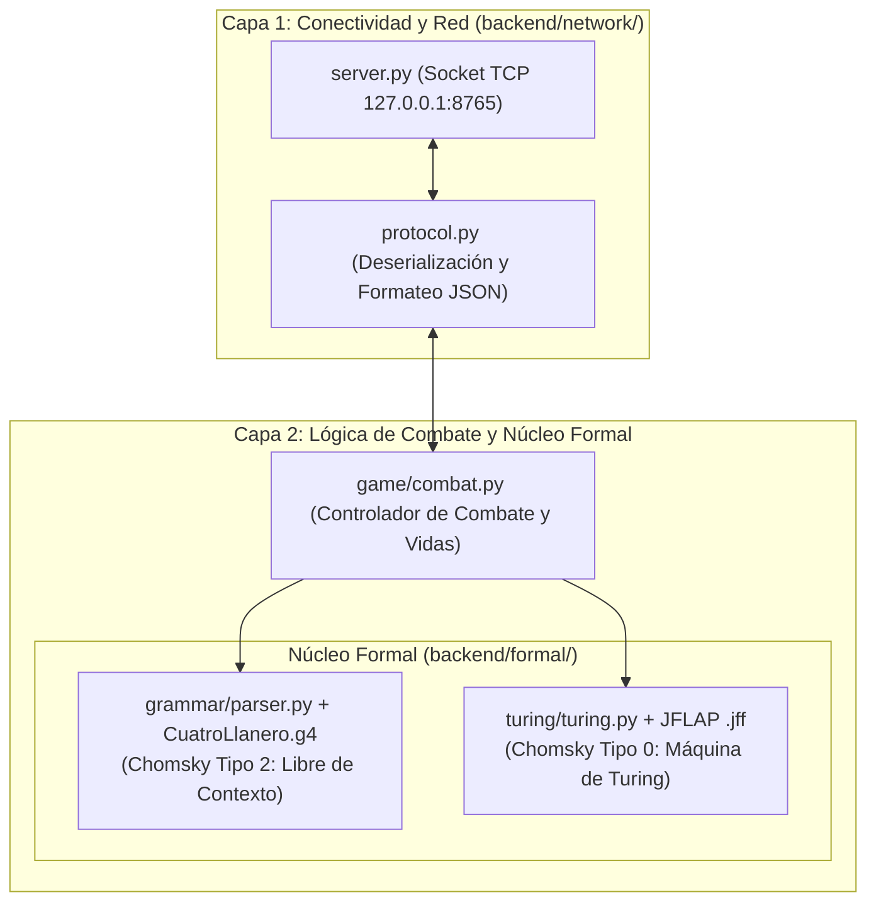

# Arquitectura y Fundamentación Formal del Backend

Este documento describe la arquitectura modular del backend en Python 3 y su correspondencia directa con la **Jerarquía de Chomsky** y los métodos formales evaluados en el curso de **Lenguajes de Programación**.

---

## 1. Arquitectura de Dos Capas

El backend opera como un proceso autónomo y liviano organizado en dos capas desacopladas:

| Módulo | Responsabilidad | Fundamentación Teórica |
|---|---|---|
| [`backend/network/`](../../backend/network/) | Servidor TCP y serialización JSON delimitada por salto de línea | Comunicación inter-procesos (IPC) sin sobrecarga HTTP |
| [`backend/game/`](../../backend/game/) | Controlador de vidas, daño y resolución de turnos | Reglas del juego (Matriz de daño y parry) |
| [`backend/formal/grammar/`](../../backend/formal/grammar/) | Analizador sintáctico de los golpes del cuatro llanero | **Chomsky Tipo 2:** Gramática Libre de Contexto en ANTLR4 |
| [`backend/formal/turing/`](../../backend/formal/turing/) | Autómata determinista de 3 cintas para la IA del enemigo | **Chomsky Tipo 0:** Máquina de Turing Multicinta y modelo JFLAP |

---

## 2. Correspondencia con la Jerarquía de Chomsky

Para la sustentación académica, el proyecto divide claramente los niveles de poder computacional:

1. **Tipo 2 – Gramática Libre de Contexto (Música del Cuatro):**
   - Archivo de definición: [`CuatroLlanero.g4`](../../backend/formal/grammar/CuatroLlanero.g4).
   - Valida que la combinación de acordes ejecutados por el jugador respete la estructura tradicional del joropo llanero (*Gabán, Pajarillo, Seis por Derecho, Zumbe y Zumbe, Tonada, Contrapunteo recursivo*).
   - Emite una acción clasificada: `A` (Ataque), `D` (Defensa), `C` (Curación) o `E` (Error sintáctico por cuerda desafinada).

2. **Tipo 0 – Máquina de Turing Multicinta (IA Táctica del Enemigo):**
   - Archivos: [`turing.py`](../../backend/formal/turing/turing.py) y [`maquina_turing_enemigo.jff`](../../backend/formal/turing/maquina_turing_enemigo.jff).
   - El enemigo no usa números aleatorios (`random`), sino un autómata determinista de 3 cintas:
     - **Cinta 1:** Historial de acordes/acciones del jugador.
     - **Cinta 2:** Estado de Furia y contador Anti-Spam.
     - **Cinta 3:** Decisión táctica (`ATAQUE_RAPIDO`, `ATAQUE_PESADO`, `BLOQUEO`, `CASTIGO`).

---

## 3. Protocolo de Integración con Godot

El detalle completo de las tramas JSON enviadas y recibidas por el cliente Godot se encuentra documentado en:
* [`protocolo_comunicacion_godot_python.md`](./protocolo_comunicacion_godot_python.md)
