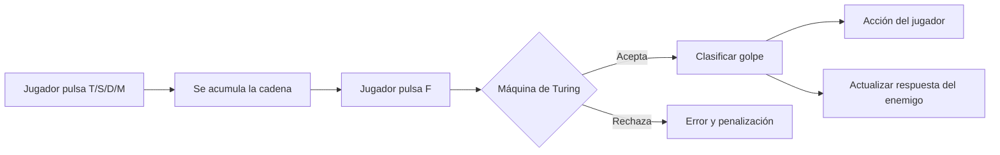
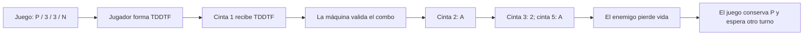

# Máquina de Turing del cuatro llanero

El archivo [`maquina_cuatro.jff`](./maquina_cuatro.jff) contiene una máquina de Turing determinista de una cinta, compatible con JFLAP. Su función es validar la cadena que llega después de que el jugador presiona el `Frenao (F)`.

## Alfabeto

- `T`: tónica.
- `S`: subdominante.
- `D`: dominante.
- `M`: menor relativo.
- `F`: frenao y cierre de la secuencia.

La máquina conserva cada símbolo de entrada y desplaza el cabezal hacia la derecha. Si encuentra una combinación que no corresponde a una transición, la cadena se rechaza. Después de leer `F`, pasa a `qFin`; únicamente acepta si el siguiente símbolo es blanco. Esto evita aceptar una secuencia válida seguida de símbolos adicionales.

## Estados y situaciones modeladas

| Secuencia | Estados principales | Resultado semántico |
|---|---|---|
| `TDDTF` | `qT -> qTD -> qTDD -> qTDDT` | Golpe de Gabán: ataque básico |
| `MSDMF` | `qM -> qMS -> qMSD -> qMSDM` | Golpe de Pajarillo: ataque fuerte |
| `TSDTF` | `qT -> qTS -> qTSD -> qTSDT` | Seis por Derecho: escudo/parry |
| `SDSDF` | `qS -> qSD -> qSDS -> qSDSD` | Zumbe y Zumbe: esquive/aturdimiento |
| `TMSTF` | `qT -> qTM -> qTMS -> qTMST` | Tonada: curación o mejora |
| `TDSDT(SDT)*F` | `qTD -> qTDS -> qTDSD -> qTDSDT` | Contrapunteo: combo recursivo |

En la última regla, el primer ciclo `SDT` es obligatorio. Desde `qTDSDT`, la máquina puede leer `F` para cerrar el combo o volver a `qTDS` al leer `S`, acumulando otro ciclo `SDT`.

## Flujo completo



### Integración con la arquitectura documentada

1. **Entrada:** Godot o Pygame recoge las teclas y forma, por ejemplo, `TDDTF`. En la arquitectura cliente-servidor, esa cadena puede viajar como `{"secuencia":"TDDTF"}`; en el monolito se entrega directamente al objeto de la máquina.
2. **Validación:** ANTLR puede realizar el análisis sintáctico descrito en la documentación. Esta máquina implementa la misma validación como reconocedor ejecutable en JFLAP y sirve para visualizar el recorrido de estados y la cinta.
3. **Semántica:** al alcanzar `qAcepta`, el estado final se traduce a la acción indicada en la tabla. JFLAP no ejecuta por sí solo el daño, el escudo o el audio: el backend debe asociar el resultado con la acción del juego.
4. **Respuesta enemiga:** la aplicación usa esa acción y el estado actual del enemigo para decidir si recibe daño, queda aturdido, se cura el jugador o se ejecuta un parry.

Aunque el diseño general menciona una máquina multicinta, este `.jff` prioriza la compatibilidad directa con JFLAP. La separación conceptual puede conservarse así: cinta 1 para la secuencia, cinta 2 para el nombre de la acción y cinta 3 para el estado enemigo. Las cintas 2 y 3 son datos semánticos que el backend puede mantener al recibir la aceptación de esta máquina.

## Pruebas sugeridas en JFLAP

### Deben aceptarse

```text
TDDTF
MSDMF
TSDTF
SDSDF
TMSTF
TDSDTF
TDSDTSDTF
```

### Deben rechazarse

```text
TTDF
TDDT
TDSDF
TDSDT
TDDTFF
TDDTFM
```

Para probarla, abre el `.jff` en JFLAP, selecciona **Input > Multiple Run**, ingresa las cadenas y ejecuta la simulación. El estado `qAcepta` representa una validación exitosa; cualquier entrada sin transición representa una entrada inválida.

## Máquina de juego multicinta

El archivo [`maquina_juego_multicinta_v2.jff`](./maquina_juego_multicinta_v2.jff) conserva la máquina anterior y agrega el comportamiento del combate. Esta es la máquina que debe abrirse y conectarse al juego. El archivo `maquina_juego_multicinta.jff` es la versión anterior; no lo uses si JFLAP ya lo modificó al abrirlo.

### Cintas

| Cinta | Contenido | Símbolos iniciales |
|---|---|---|
| 1 | Secuencia musical del jugador | `T`, `S`, `D`, `M`, `F` |
| 2 | Estado global del juego | `P` = jugando, `V` = victoria |
| 3 | Estado/vida del enemigo | `3`, `2`, `1`, `0` |
| 4 | Estado/vida del jefe | `3`, `2`, `1`, `0` |
| 5 | Acción producida | `N` = ninguna |

`3`, `2` y `1` representan tres, dos y una unidad de vida; `0` significa derrotado. La misma convención se usa para el jefe. Cada símbolo ocupa una celda de su cinta, por lo que JFLAP puede leerlo como un símbolo válido de un solo carácter.

### Acciones producidas

| Combo | Acción escrita en cinta 2 | Efecto |
|---|---|---|
| `TDDTF` | `A` | Gabán: resta una vida al enemigo |
| `MSDMF` | `R` | Pajarillo: resta dos vidas al enemigo |
| `TSDTF` | `D` | Seis por Derecho: defensa/parry, no causa daño |
| `SDSDF` | `Z` | Zumbe y Zumbe: esquiva/aturde, no causa daño |
| `TMSTF` | `H` | Tonada: curación o mejora, no causa daño |
| `TDSDT(SDT)*F` | `C` | Contrapunteo: resta una vida al jefe |

Si el jefe pasa de `1` a `0`, la cinta 2 queda en `V`, la cinta 5 queda en `C` y la máquina acepta en el estado `qAcepta`: es la victoria. Si el juego inicia con un estado distinto de `P`, no existe transición y la entrada se rechaza; el backend debe tratarlo como una partida ya terminada.

### Flujo de un turno



Para el siguiente turno, el programa debe usar los valores escritos por la máquina como nueva entrada de estado. Por ejemplo:

```text
Turno inicial:  cinta 1=TDDTF | cinta 2=P | cinta 3=3 | cinta 4=3 | cinta 5=N
Resultado:      cinta 2=P     | cinta 3=2 | cinta 4=3 | cinta 5=A
Siguiente turno: cinta 1=MSDMF | cinta 2=P | cinta 3=2 | cinta 4=3 | cinta 5=N
Resultado:      cinta 2=P     | cinta 3=0 | cinta 4=3 | cinta 5=R
```

El backend de Godot o Pygame traduce `A`, `R`, `D`, `Z`, `H` y `C` a animación, audio y actualización visual. La máquina no dibuja el juego: su responsabilidad formal es validar la entrada y producir el nuevo estado de combate.

### Pruebas multicinta

En JFLAP usa una entrada de cinco cintas. Para la primera prueba configura:

```text
Cinta 1: TDDTF
Cinta 2: P
Cinta 3: 3
Cinta 4: 3
Cinta 5: N
```

Debe terminar en `qAcepta` con `P`, `2`, `3` y `A` escritos. También puedes probar `MSDMF` con `2` para derrotar al enemigo, o repetir `TDSDTF` tres veces con el jefe en `3` para llegar a `V`, `0` y `C`.

### Ejecución sencilla en JFLAP

La máquina fue ajustada para que también funcione cuando solo escribes el combo en la cinta 1. En ese caso deja las cintas 2, 3, 4 y 5 vacías: al leer el primer tono, la máquina las inicializa automáticamente como `P`, `3`, `3` y `N`. Todos los símbolos son de un solo carácter, porque JFLAP no acepta símbolos como `E3` o `B3`. El archivo usa el atributo `tape="1"` hasta `tape="5"` en cada lectura, escritura y movimiento.

Para comprobar `TDDTF`:

```text
Cinta 1: TDDTF
Cinta 2: (vacía)
Cinta 3: (vacía)
Cinta 4: (vacía)
Cinta 5: (vacía)
```

En **Input > Multiple Run**, selecciona la opción de máquina multicinta y proporciona las cinco entradas en ese orden. No escribas `    ` como una cadena única separada por `;`; cada cinta tiene su propio campo. El resultado esperado es aceptación, con `P` en la cinta 2, `2` en la cinta 3, `3` en la cinta 4 y `A` en la cinta 5.

Importante: cierra en JFLAP cualquier copia anterior de la máquina antes de abrir `maquina_juego_multicinta_v2.jff`. La versión nueva contiene explícitamente `T`, `M` y `S` en las transiciones que salen de `qInicio`.
