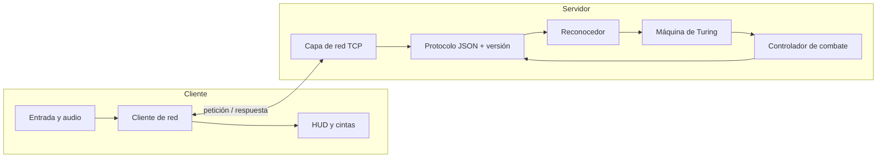
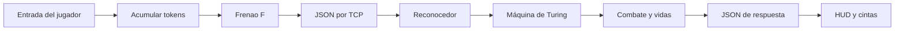
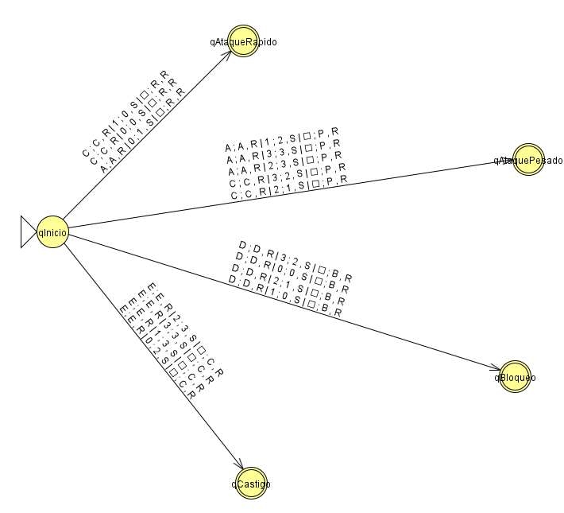

# El Cuatro Llanero: gramática libre de contexto y máquina de Turing multicinta como mecánicas de un videojuego de combate

**Informe del proyecto — versión de lectura en Markdown**

> Esta es la versión legible del artículo. La versión con formato IEEE (*Conference Template v1.1*, `\documentclass[9pt]{ieeeconf}`, autores con `\addauthor`/`\addaffiliation`) está en [`main.tex`](./main.tex) y las referencias en [`refs.bib`](./refs.bib).

**Autores:** Jessica Marcela Baquero Mejía (160004303), Nicolas Steven Lozano Castro (160004520), Deivid Julian Hernandez Ortiz (160004211)  
**Afiliación:** Programa de Ingeniería de Sistemas, Universidad de los Llanos, Villavicencio, Colombia  
**Palabras clave:** lenguajes formales, gramáticas libres de contexto, máquina de Turing multicinta, lenguajes específicos de dominio, videojuego, generación procedural.

---

## Resumen

Las gramáticas libres de contexto y las máquinas de Turing se estudian casi siempre sobre cadenas de laboratorio, separadas del software que las usa. Sin embargo, son la misma clase de objetos que sostiene buena parte de la producción de videojuegos: lenguajes de guion, gramáticas de contenido y autómatas de comportamiento. Este trabajo presenta el diseño y la implementación de **El Cuatro Llanero**, un prototipo de combate isométrico en el que la gramática libre de contexto y la máquina de Turing son la mecánica central. El jugador acumula los símbolos `T`, `S`, `D` y `M`, cierra la secuencia con el *Frenao* `F` y solo entonces el juego reconoce uno de seis golpes, incluido un contrapunteo recursivo de longitud variable. El enemigo es una máquina de Turing determinista de tres cintas que registra el historial, acumula furia, detecta la repetición y elige entre cuatro respuestas tácticas. La arquitectura separa la comunicación —un protocolo TCP con mensajes JSON versionados— del núcleo formal. El resultado es un modelo ejecutable y verificable, que puede dibujarse en JFLAP y que muestra cómo las reglas formales se convierten en contenido de juego y no en una envoltura didáctica.

---

## 1. Introducción

Los lenguajes formales y los autómatas permiten especificar y verificar cómo se construyen, reconocen y procesan las cadenas de símbolos. Estas herramientas se aplican ampliamente en compiladores, lenguajes de dominio específico y sistemas de software, pero su enseñanza suele mantenerse separada de las aplicaciones interactivas [1], [5], [9]. En particular, los modelos formales rara vez se integran de forma directa en el comportamiento observable de un videojuego.

Este trabajo presenta **El Cuatro Llanero**, un prototipo de combate isométrico ambientado en la sabana llanera. El jugador ejecuta secuencias musicales con el cuatro, y cada secuencia se reconoce como una de seis acciones mediante una gramática libre de contexto. El enemigo utiliza una máquina de Turing determinista de tres cintas para conservar el historial de acciones, calcular la furia y la repetición, y seleccionar una respuesta táctica [2], [3].

El objetivo general es diseñar e implementar una arquitectura que integre estos dos modelos formales con un sistema de combate ejecutable. La solución separa el núcleo formal de la comunicación y la presentación: ANTLR4 especifica el lenguaje del jugador, la máquina de Turing administra la memoria y las decisiones del enemigo, y un protocolo TCP con mensajes JSON conecta ambos componentes con el cliente. Así, el proyecto demuestra cómo las gramáticas y los autómatas pueden convertirse en mecánicas verificables y reproducibles dentro de un videojuego [10], [11].

### 1.1 Planteamiento del problema

El problema que aborda este trabajo tiene dos dimensiones. La primera es de formación: los modelos formales se aprenden como definiciones y no como componentes de un sistema, de modo que el estudiante pierde la oportunidad de ver cómo una gramática restringe la interacción o cómo un autómata acumula estado [18], [10]. La segunda es de ingeniería: integrar un analizador sintáctico y una máquina en un videojuego exige resolver el transporte de datos, la serialización, la sincronización del estado y la separación entre la lógica formal y la presentación visual [11], [9].

La pregunta de investigación es: *¿qué diseño de arquitectura y de modelado formal permite que una gramática libre de contexto y una máquina de Turing multicinta funcionen como mecánicas centrales de un videojuego de combate, preservando corrección, determinismo y respuesta interactiva en una ejecución local?*

### 1.2 Solución propuesta

La solución se organiza en cuatro piezas:

1. un lenguaje de cinco símbolos que abstrae el cuatro y permite ejecutar acordes sin conocimientos musicales;
2. una gramática libre de contexto que reconoce seis golpes, incluido un contrapunteo recursivo de longitud variable;
3. una máquina de Turing de tres cintas que modela la memoria del enemigo, su furia y su decisión táctica;
4. una arquitectura cliente-servidor con un protocolo TCP y mensajes JSON versionados.

El cliente se ocupa de la entrada, el audio y la visualización; el servidor se ocupa de la validación, la máquina y el combate. Esta división permite que el modelo formal sea determinista y verificable, y que la presentación cambie sin reescribir la lógica [9].

### 1.3 Objetivos

El objetivo general es diseñar, implementar y validar un prototipo de videojuego cuyo combate esté determinado por una gramática libre de contexto y una máquina de Turing multicinta, con una arquitectura cliente-servidor que pueda ejecutarse localmente.

Objetivos específicos:

1. formalizar el lenguaje del cuatro llanero como una gramática libre de contexto con seis golpes y una regla recursiva;
2. implementar la gramática en ANTLR4 y un reconocedor equivalente que no dependa de un *runtime* externo;
3. modelar la inteligencia del enemigo como una máquina de Turing determinista de tres cintas;
4. definir una matriz de resolución de combate que cruce la acción del jugador con la decisión del enemigo;
5. construir una arquitectura de dos capas con un protocolo TCP y un contrato de mensajes versionado;
6. documentar la correspondencia entre el modelo ejecutable y una proyección dibujable en JFLAP;
7. situar el resultado en el contexto de la industria, donde gramáticas y autómatas cumplen funciones de producción.

### 1.4 Contribuciones

- Una formalización del cuatro llanero como lenguaje regular presentado mediante una gramática libre de contexto, con discusión explícita de su poder expresivo.
- Una máquina de Turing multicinta determinista con función de transición documentada y proyección verificable en JFLAP.
- Una arquitectura de dos capas y un contrato de mensajes que aíslan el núcleo formal del cliente.
- Un argumento de diseño que conecta esas piezas con prácticas reales de la industria: contenido generado por gramáticas, lenguajes de guion y autómatas de comportamiento [12], [13].

### 1.5 Organización

La sección 2 presenta el marco teórico y los trabajos relacionados. La sección 3 describe el lenguaje del juego y su gramática. La sección 4 detalla la arquitectura, la máquina de Turing y el protocolo. La sección 5 documenta la implementación. La sección 6 presenta los resultados y su alcance. La sección 7 cierra con la utilidad industrial del modelo y el trabajo futuro.

---

## 2. Marco teórico y trabajos relacionados

### 2.1 Gramáticas libres de contexto

Una gramática libre de contexto es una cuádrupla $G=(V,\Sigma,R,S)$, donde $V$ es el conjunto finito de no terminales, $\Sigma$ el alfabeto de terminales, $R\subseteq V\times(V\cup\Sigma)^*$ el conjunto finito de producciones y $S\in V$ el símbolo inicial [2], [3]. El lenguaje generado es

$$L(G)=\{w\in\Sigma^* \mid S\Rightarrow^* w\}.$$

Una derivación es una secuencia de formas sentenciales en la que cada paso aplica una producción. El árbol de derivación hace visible la estructura sintáctica. Una gramática es **no ambigua** cuando cada cadena del lenguaje tiene un único árbol de derivación; la univocidad es deseable en cualquier lenguaje que vaya a ejecutarse, porque garantiza que la interpretación de una entrada no dependa del orden en que el analizador explore las alternativas [2].

La notación de Backus-Naur (BNF), popularizada por los informes de ALGOL, es la forma habitual de escribir estas gramáticas en ingeniería [4], [10].

### 2.2 Analizadores y lenguajes específicos de dominio

Un lenguaje de programación se especifica con una gramática y se implementa con un analizador; esa separación entre especificación y mecanismo es una de las ideas más productivas de la informática [4], [5], [10]. ANTLR4 genera analizadores descendentes a partir de una gramática declarativa y emplea el algoritmo LL(*) para resolver alternativas con *lookahead* arbitrario [6], [17].

La misma técnica sostiene los **lenguajes específicos de dominio**: pequeños lenguajes diseñados para que un experto —un diseñador de niveles, un guionista, un artista técnico— exprese reglas sin programar [10]. Cuando el dominio es un juego, el lenguaje suele describir contenido: secuencias de combate, condiciones de una misión, diálogos con ramificaciones.

### 2.3 Máquinas de Turing multicinta

Una máquina de Turing determinista de $k$ cintas se define como

$$\mathcal{M}=(Q,\Gamma,\Sigma,\delta,q_0,\square,F),$$

donde $Q$ es el conjunto finito de estados, $\Gamma$ el alfabeto de cinta, $\Sigma\subseteq\Gamma$ el alfabeto de entrada, $q_0$ el estado inicial, $\square\in\Gamma\setminus\Sigma$ el blanco y $F\subseteq Q$ los estados finales. La función de transición es

$$\delta: Q\times\Gamma^k \longrightarrow Q\times\Gamma^k\times\{L,R,S\}^k.$$

En cada paso la máquina lee los $k$ símbolos bajo los cabezales, escribe $k$ símbolos, mueve cada cabezal y cambia de estado. La equivalencia con la máquina de una cinta es un resultado clásico [2], [3]; la versión multicinta se prefiere aquí porque hace explícitos el historial, el estado interno y la decisión, y porque permite dibujar cada cinta por separado en la interfaz.

El costo de un paso es $O(1)$ y el de procesar una cadena de longitud $n$ es $O(n)$.

### 2.4 Gramáticas y autómatas en la producción de videojuegos

La industria del videojuego usa estos modelos a diario, aunque rara vez con esos nombres:

- **Contenido.** La generación procedural emplea gramáticas para producir niveles, misiones, árboles de habilidades y narrativa: el diseñador escribe reglas y el sistema enumera variantes válidas [12].
- **Lenguajes.** Los motores exponen lenguajes de guion y de configuración que se compilan con analizadores generados; los patrones de intérprete y de máquina virtual aparecen en cualquier motor que ejecute contenido de usuario [11], [9].
- **Comportamiento.** Los personajes se especifican con máquinas de estado finito y, más recientemente, con árboles de comportamiento que las generalizan [13].
- **Diseño de reglas.** Qué acciones existen, cuándo son legales y cómo se resuelven es el objeto central del diseño de juegos [7], [14].

Ese es el punto de apoyo de este trabajo: el mismo vocabulario que explica un autómata de laboratorio explica un sistema de combate, un diálogo ramificado o un generador de mazmorras. La diferencia entre un ejercicio y un producto no está en la teoría, sino en si la teoría gobierna algo que el jugador percibe.

### 2.5 Juegos serios y diseño de mecánicas

La literatura sobre juegos serios reporta efectos positivos en motivación y aprendizaje, aunque advierte sobre la heterogeneidad metodológica de los estudios [15], [18]. El marco MDA (mecánicas, dinámicas y estéticas) propone diseñar primero las reglas que producen la experiencia [16]; *Rules of Play* insiste en que las reglas son el objeto central del diseño [7].

### 2.6 JFLAP como herramienta de revisión

JFLAP es un entorno interactivo para construir y simular autómatas, gramáticas y máquinas de Turing [8]. Su valor aquí es de auditoría y de comunicación: permite dibujar la máquina, recorrer la cinta paso a paso y comprobar que la función de transición descrita en el texto coincide con una implementación visual. JFLAP impone restricciones prácticas: cada celda contiene un solo carácter y el estado de una ejecución no se conserva entre simulaciones.

---

## 3. El lenguaje del juego

### 3.1 Del cuatro llanero a un alfabeto

| Token | Nombre | Tecla | Papel |
|---|---|---|---|
| `T` | Tónica | `A` | Reposo armónico |
| `S` | Subdominante | `S` | Transición |
| `D` | Dominante | `D` | Tensión |
| `M` | Menor relativo | `W` | Color menor |
| `F` | Frenao | Espacio | Fin de cadena |

El jugador puede pulsar `T`, `S`, `D` y `M` en cualquier orden mientras acumula una secuencia; el sonido se reproduce localmente en el cliente. El símbolo `F` no es un acorde: cierra la cadena y dispara la petición al servidor.

### 3.2 Los seis golpes

| Golpe | Secuencia | Tipo | Acción | Daño |
|---|---|---|---|---|
| Gabán | `TDDTF` | Ataque | A | 15 |
| Pajarillo | `MSDMF` | Ataque | A | 30 |
| Seis por Derecho | `TSDTF` | Defensa | D | 0 |
| Zumbe y Zumbe | `SDSDF` | Evasión | D | 0 |
| Tonada de Sabana | `TMSTF` | Curación | C | 0 |
| Contrapunteo | `TD(SDT)ⁿF` | Combo | A | 25 |

El contrapunteo se produce como `TD <bordoneo> F`, donde `<bordoneo>` genera uno o más ciclos `SDT`. El primer ciclo es obligatorio; cada ciclo adicional alarga el combo, y el jugador puede cerrar con `F` cuando lo desee. El daño se mantiene en 25 para no desbalancear el combate: la regla premia la ejecución, no el poder. Es el mismo principio con el que un generador de contenido produce variaciones a partir de reglas [12].

### 3.3 Gramática formal

```
<ejecucion>    ::= <golpe> EOF
<golpe>        ::= <gaban> | <pajarillo> | <seisPorDerecho>
                 | <zumbeYZumbe> | <tonada> | <contrapunteo>
<gaban>        ::= T D D T F
<pajarillo>    ::= M S D M F
<seisPorDerecho> ::= T S D T F
<zumbeYZumbe>  ::= S D S D F
<tonada>       ::= T M S T F
<contrapunteo> ::= T D <bordoneo> F
<bordoneo>     ::= S D T | S D T <bordoneo>
```

El lenguaje generado es

$$L(G)=\{\texttt{TDDTF},\texttt{MSDMF},\texttt{TSDTF},\texttt{SDSDF},\texttt{TMSTF}\}\cup\{\texttt{TD}(\texttt{SDT})^n\texttt{F}\mid n\ge 1\}.$$

Por ejemplo, para $n=2$ la cadena es `TDSDTSDTF`, que se obtiene aplicando una vez la regla recursiva:

```
<ejecucion> ⇒ <golpe> ⇒ <contrapunteo>
            ⇒ TD <bordoneo> F
            ⇒ TDSDT <bordoneo> F
            ⇒ TDSDTSDTF
```

Cada paso aplica una única producción y consume exactamente un bloque `SDT`; por eso la derivación es única.

### 3.4 Propiedades y discusión

**Univocidad.** Las cinco alternativas fijas son cadenas distintas y el contrapunteo comienza con `TD` seguido de `S`, por lo que no se solapa con `TDDTF`. La regla de `bordoneo` es recursiva por la derecha y cada paso consume exactamente `SDT`; por inducción, la derivación es única. En un juego, eso significa que una combinación de teclas produce siempre el mismo golpe [2].

**Clase del lenguaje.** La gramática no es estrictamente regular: en `<contrapunteo> → TD <bordoneo> F` el no terminal queda seguido del terminal `F`. Sin embargo, el lenguaje generado sí es regular: `<bordoneo>` genera `(SDT)+`, de modo que el contrapunteo es `TD(SDT)+F`, y la unión con las cinco cadenas fijas es una unión finita de lenguajes regulares. Un autómata finito podría reconocerlo; la máquina de Turing no es necesaria para decidirlo [3]. La gramática libre de contexto se usa como especificación legible y extensible, y la máquina de Turing como modelo de estado del enemigo. Un lenguaje estrictamente no regular exigiría una estructura anidada o un mecanismo de pila explícito.

**Complejidad.** El reconocimiento se puede hacer en $O(n)$ tiempo y $O(1)$ espacio adicional recorriendo la cadena en grupos de tres.

**Extensibilidad.** Añadir un golpe consiste en agregar una alternativa a `golpe` y una entrada a la tabla de daño; añadir una decisión del enemigo consiste en agregar una fila a la función de transición [11].

### 3.5 Del turno formal al tiempo real

El núcleo formal resuelve turnos discretos, pero el juego se presenta como un combate en tiempo real con ventanas de reacción. El cliente muestra la telegrafía del enemigo, concede una ventana de pocos segundos y acumula la secuencia; cuando el jugador pulsa `F`, envía la cadena y espera la respuesta. El servidor no modela el tiempo: resuelve una transición por petición. Así, el tiempo real vive en la presentación y el determinismo en el núcleo [11].

La arena refuerza esta separación: al detectar un jefe, la cámara se bloquea y aparece un muro espectral que impide abandonar el área; el contacto con el borde aplica daño o empuje.

---

## 4. Arquitectura y diseño formal de la solución

### 4.1 Visión general



La capa de conectividad acepta conexiones TCP, delimita mensajes JSON por salto de línea y serializa las respuestas. La capa de lógica formal valida la gramática, actualiza la máquina de Turing y resuelve el combate. El cliente solo conoce el contrato de mensajes. La separación sigue la recomendación clásica de aislar la lógica de dominio de la infraestructura y de la presentación [11], [9].

### 4.2 Flujo de un turno



Con la acción resultante ($A$, $D$, $C$ o $E$), la máquina actualiza sus tres cintas y emite una decisión. El controlador aplica el daño, actualiza las vidas y construye la respuesta, que incluye los instantáneos de las cintas y las posiciones de los cabezales.

### 4.3 Reconocedor del jugador

```
grammar CuatroLlanero;

ejecucion : golpe EOF ;
golpe
    : gaban | pajarillo | seisPorDerecho
    | zumbeYZumbe | tonada | contrapunteo
    ;
gaban        : TONICA DOMINANTE DOMINANTE TONICA FRENAO ;
pajarillo    : MENOR SUBDOM DOMINANTE MENOR FRENAO ;
seisPorDerecho : TONICA SUBDOM DOMINANTE TONICA FRENAO ;
zumbeYZumbe  : SUBDOM DOMINANTE SUBDOM DOMINANTE FRENAO ;
tonada       : TONICA MENOR SUBDOM TONICA FRENAO ;
contrapunteo : TONICA DOMINANTE bordoneo FRENAO ;
bordoneo     : SUBDOM DOMINANTE TONICA
             | SUBDOM DOMINANTE TONICA bordoneo
             ;

TONICA : 'T' ; SUBDOM : 'S' ; DOMINANTE : 'D' ;
MENOR : 'M' ; FRENAO : 'F' ;
WS : [ \t\r\n]+ -> skip ;
```

El servidor no compila la gramática en tiempo de ejecución: usa un reconocedor recursivo con la misma estructura, lo que reduce dependencias. La gramática sigue siendo la fuente de verdad documental y puede compilarse cuando se quiera generar un analizador alternativo [6], [17].

Si la cadena no pertenece al lenguaje, el reconocedor devuelve un resultado inválido con acción `E`; el controlador trata esa acción como error sintáctico y la máquina responde con castigo. Esta es la articulación central del diseño: la respuesta del sistema depende de una decisión de pertenencia, como en un compilador que rechaza un programa mal formado [4], [6].

### 4.4 Máquina de Turing del enemigo

| Cinta | Contenido | Alfabeto | Movimiento |
|---|---|---|---|
| 1 | Historial de acciones | A, D, C, E | avanza |
| 2 | Furia y repetición | 0, 1, 2, 3 | se queda |
| 3 | Decisiones tácticas | Nombres / R, P, B, C | avanza |

En cada turno la máquina recibe un único símbolo de entrada —la acción que el reconocedor clasificó— y, en un solo paso, deja el historial actualizado, los contadores nuevos y la decisión. Formalmente, es la séptupla

$$\mathcal{M}=(Q,\Sigma,\Gamma,\delta,q_0,\square,F),$$

donde:

- $Q=\{q_{\text{inicio}},q_{\text{rapido}},q_{\text{pesado}},q_{\text{bloqueo}},q_{\text{castigo}}\}$ es el conjunto de estados;
- $\Sigma=\{A,D,C,E\}$ es el alfabeto de entrada;
- $\Gamma=\Gamma_1\times\Gamma_2\times\Gamma_3$ es el alfabeto de las tres cintas, con $\Gamma_1=\{A,D,C,E,\square\}$, $\Gamma_2=\{0,1,2,3,\square\}$ y $\Gamma_3=\{\text{ATAQUE\_RAPIDO},\text{ATAQUE\_PESADO},\text{BLOQUEO},\text{CASTIGO},\square\}$;
- $q_0=q_{\text{inicio}}$ es el estado inicial y $\square$ el blanco;
- $F=Q\setminus\{q_0\}$ es el conjunto de estados finales.

La función de transición es $\delta: Q\times\Gamma \to Q\times\Gamma\times\{L,R,S\}^3$ y siempre parte del estado inicial, porque cada turno es independiente del anterior salvo por lo que dicen las cintas:

$$\delta\big(q_0,(a,(f,r),\square)\big)=\big(q_d,(a,(f',r'),d),(R,S,R)\big).$$

Aquí $a$ es la acción; $f$ y $r$, la furia y la repetición antes del turno; $f'$, $r'$ y $d$, la furia, la repetición y la decisión después del turno. Los tres valores se calculan así.

**Furia.** Empieza en 0. Un ataque la sube uno; un error sintáctico la sube dos; una defensa o una curación la bajan uno. Nunca sale de $[0,3]$.

**Repetición.** Empieza en 1. Si la acción es igual a la anterior, sube uno; si cambia, vuelve a 1. El tope es 3, y llegar a 3 anuncia castigo. La acción anterior se lee en la celda previa de la cinta 1.

**Decisión.** Se evalúa en este orden: un error o una repetición en el tope producen castigo; una defensa produce bloqueo; una furia de 2 o más produce ataque pesado; en cualquier otro caso, ataque rápido. El orden importa: un error o una tercera repetición producen castigo incluso si la acción es defensiva; sin embargo, una acción $D$ anula el daño, por lo que un castigo contra una defensa repetida no resta vida.

| Estado | Condición | Decisión | Daño |
|---|---|---|---|
| q_inicio | inicio del turno | — | — |
| q_castigo | a = E o r′ = 3 | CASTIGO | 35 |
| q_bloqueo | a = D | BLOQUEO | 0 |
| q_pesado | f′ ≥ 2 | ATAQUE_PESADO | 20 |
| q_rapido | en otro caso | ATAQUE_RAPIDO | 10 |

Con esas tres reglas y la prioridad indicada, δ queda completamente determinada: para cada acción y cada valor de furia hay una sola fila. Esa unicidad es la condición de determinismo: dos partidas con la misma secuencia de acciones terminan igual.

En la proyección JFLAP la cinta 2 contiene solo la furia y la cinta 3 usa códigos de una letra ($R$ ataque rápido, $P$ ataque pesado, $B$ bloqueo, $C$ castigo), porque cada celda admite un solo carácter. El contador de repetición no se conserva entre ejecuciones de JFLAP y permanece en el estado del programa.

### 4.5 Resolución del combate

El daño que el jugador inflige depende del golpe: 30 para Pajarillo, 25 para Contrapunteo, 15 para Gabán y 0 para las acciones defensivas o de curación. El daño que recibe depende de la decisión enemiga: 10 para ataque rápido, 20 para ataque pesado y 35 para castigo. Si la acción del jugador es $D$, el daño recibido es 0: es el *parry* musical.

El orden de resolución es: (1) validar y clasificar; (2) actualizar la máquina; (3) calcular el daño al enemigo; (4) si el enemigo llega a 0, no hay contraataque; (5) aplicar el daño al jugador; (6) determinar el estado.

| Secuencia | ¿Válida? | Golpe | Acción | Daño al enemigo | Decisión enemiga | Daño al jugador |
|---|---|---|---|---|---|---|
| `TDDTF` | Sí | Gabán | A | 15 | ATAQUE_RAPIDO | 10 |
| `MSDMF` | Sí | Pajarillo | A | 30 | ATAQUE_RAPIDO | 10 |
| `TSDTF` | Sí | Seis por Derecho | D | 0 | BLOQUEO | 0 |
| `SDSDF` | Sí | Zumbe y Zumbe | D | 0 | BLOQUEO | 0 |
| `TMSTF` | Sí | Tonada de Sabana | C | 0 | ATAQUE_RAPIDO | 10 |
| `TDSDTF` | Sí | Contrapunteo | A | 25 | ATAQUE_RAPIDO | 10 |
| `TDSDTSDTF` | Sí | Contrapunteo | A | 25 | ATAQUE_RAPIDO | 10 |
| `TTDF` | No | — | E | 0 | CASTIGO | 0 |

La repetición se mide sobre la categoría de acción, no sobre la secuencia exacta. Dos golpes distintos que comparten la acción $A$ cuentan como repetición. Si se quisiera distinguir canciones, la cinta 1 tendría que almacenar el identificador del golpe y la máquina tendría más símbolos.

### 4.6 Protocolo

La frontera entre cliente y servidor es un objeto JSON por línea sobre una conexión TCP:

```json
{"secuencia":"TDDTF"}
```

La respuesta de ese turno, desde una partida nueva, es:

```json
{"contrato_version":"1.0","valido":true,
 "golpe":"Golpe de Gaban","accion":"A","error":null,
 "dano_enemigo":15,"dano_jugador":10,
 "enemigo_accion":"ATAQUE_RAPIDO",
 "vida_jugador":90,"vida_enemigo":85,
 "estado":"JUGANDO",
 "cintas":{"cinta1":["A"],"cinta2":["1","1"],
           "cinta3":["ATAQUE_RAPIDO"]},
 "cabezales":{"L":0,"R":0,"S":0}}
```

El campo `cinta2` contiene la furia y la repetición; `cabezales` permite que el HUD resalte la celda actual. Los valores del campo `golpe` son `Golpe de Gaban`, `Golpe de Pajarillo`, `Seis por Derecho`, `Zumbe y Zumbe`, `Tonada de Sabana` y `Contrapunteo Libre`. El campo `contrato_version` vale `"1.0"`. Los esquemas siguen JSON Schema 2020-12 [19].

Una sola conexión transporta todos los turnos de una partida. El servidor distingue dos niveles de error: un JSON mal formado produce un error de protocolo; una secuencia con forma válida pero fuera del lenguaje produce una respuesta de combate con `valido=false` y acción `E`.

---

## 5. Implementación

### 5.1 Organización del núcleo

| Componente | Responsabilidad |
|---|---|
| Reconocedor | Validar la gramática y clasificar el golpe |
| Máquina de Turing | Tres cintas y decisión táctica |
| Controlador de combate | Daño, vidas y estado de la partida |
| Protocolo | Validar y serializar los mensajes |
| Servidor | Aceptar conexiones y atender turnos |
| Gramática | Especificación en ANTLR4 |
| Modelo JFLAP | Proyección revisable de la máquina |
| Contrato | Esquemas versionados de los mensajes |

El diseño aplica GRASP y SOLID: *Controller* (el manejador delega), *Information Expert* (la máquina conoce sus cintas), *Low Coupling* (el protocolo depende de una interfaz, no de sockets), *High Cohesion* y *Pure Fabrication* (el módulo de protocolo). Cada componente tiene una responsabilidad única y el cliente solo depende del contrato [9], [11].

---

## 6. Resultados

### 6.1 La máquina de Turing del enemigo



*Figura 3. Máquina de Turing de tres cintas del enemigo, construida en JFLAP. Los cinco estados corresponden a la decisión táctica; las etiquetas de cada arco indican, por cinta, el símbolo leído, el escrito y el movimiento del cabezal.*

El resultado central del trabajo es la máquina de Turing del enemigo: una especificación ejecutable y, a la vez, un objeto dibujable. Tiene cinco estados —inicio, ataque rápido, ataque pesado, bloqueo y castigo— y tres cintas; cada arco se etiqueta agrupando, por cinta, el símbolo leído, el símbolo escrito y el movimiento del cabezal. Por ejemplo, la transición hacia el castigo escribe el incremento de furia en la segunda cinta y avanza el cabezal del historial en la primera.

La estructura de la figura es la de la definición formal de la sección 4.4: del estado inicial salen las transiciones que clasifican la acción, y cada estado de decisión registra en la tercera cinta el código que el controlador leerá después. Como la máquina es determinista, para cada par (estado, símbolos leídos) hay una sola salida.

Que la máquina exista como dibujo tiene una consecuencia práctica: un diseñador puede revisarla sin leer código. Es el mismo beneficio que un diagrama de estados aporta en la producción de un juego comercial, donde el comportamiento de un personaje se discute sobre el papel antes de programarse [13].

### 6.2 Coherencia del modelo

La matriz de comportamiento resume la interacción de las tres piezas —gramática, máquina y combate— para cada golpe desde una partida nueva. Los valores son consecuencia directa de las reglas, no una tabla de constantes:

- `TDDTF` inflige 15 y recibe 10 porque la acción es $A$ y la furia inicial produce ataque rápido.
- `TSDTF` no inflige daño y anula el contraataque porque la acción $D$ activa el bloqueo y el *parry*.
- `TTDF` no pertenece al lenguaje, produce acción `E`, activa el castigo y recibe 0 de daño directo; la presentación aplica una inmovilización de 1 segundo.

La tercera repetición consecutiva ilustra el papel de la memoria. Con acciones $A,A,A$, la primera produce ataque rápido, la segunda ataque pesado y la tercera castigo, porque $r'=3$; si la acción repetida es $D$, el castigo se anuncia pero el *parry* anula el daño. El contrapunteo muestra que la gramática y la máquina son ortogonales: cualquier número de ciclos `SDT` produce el mismo daño de 25 y la misma respuesta enemiga, de modo que la destreza se mide en la ejecución y no en el poder del golpe.

### 6.3 Alcance y limitaciones

Los resultados permiten responder afirmativamente a la pregunta de investigación en lo que respecta al núcleo formal y a la arquitectura: la gramática y la máquina de Turing gobiernan el combate, el contrato es estable y el comportamiento es determinista.

Limitaciones declaradas:

1. **Capa de presentación:** el prototipo se concentra en el núcleo; la experiencia completa aún no se ha recorrido de principio a fin.
2. **Clase del lenguaje:** $L(G)$ es regular; la gramática y la máquina son elecciones de especificación y diseño, no una necesidad expresiva.
3. **Repetición por categoría:** se detecta la misma acción, no la misma canción.
4. **Concurrencia:** el controlador es único y compartido; dos clientes simultáneos podrían intercalar turnos.
5. **Persistencia:** reiniciar el proceso reinicia la partida y las cintas.
6. **Predictibilidad:** al ser determinista, el enemigo puede aprenderse; el reto es añadir variedad sin perder reproducibilidad.

Una simplificación adicional: las acciones defensivas y de curación se resuelven por su categoría. El controlador no modela el aturdimiento de Zumbe y Zumbe ni la recuperación de vida de Tonada.

---

## 7. Conclusiones y trabajo futuro

Este trabajo empezó con una pregunta de aula y terminó mostrando otra cosa: la gramática y la máquina de Turing no son solo contenido evaluable, son infraestructura de producción. En la industria del videojuego esa infraestructura aparece en cuatro frentes.

**El contenido.** Las gramáticas generan niveles, misiones, árboles de habilidades y narrativa a partir de reglas; el diseñador deja de enumerar casos y empieza a escribir el espacio de posibilidades [12]. El contrapunteo de *El Cuatro Llanero* es una versión mínima de esa idea: una regla recursiva produce infinitas cadenas válidas con un daño constante.

**El lenguaje.** Los motores incorporan lenguajes de guion, de configuración y de modificación que se compilan con analizadores generados; sin un reconocedor, el contenido de un diseñador no puede ejecutarse de forma segura [11], [9], [6]. Un juego que acepta secuencias de un jugador es, en pequeño, el mismo problema: decidir si una entrada pertenece a un lenguaje y qué hacer con ella.

**El comportamiento.** Las máquinas de estado finito siguen siendo el esqueleto de la inteligencia de los personajes, y los árboles de comportamiento se entienden mejor como una generalización de esa idea [13]. La máquina de tres cintas muestra por qué: separar historial, estado interno y decisión hace que el comportamiento sea legible, discutible y modificable.

**La reproducibilidad.** Un núcleo determinista permite repetir una partida, comparar dos versiones del balance y auditar una queja; esa propiedad, que en un juego comercial se persigue con registros y semillas, aquí es una consecuencia del modelo [11]. A ello se suma el valor de diseño: cuando la regla formal es la mecánica, el diseñador y el programador trabajan sobre el mismo objeto, y la discusión sobre «qué se siente justo» se puede resolver sobre una tabla de transición [7], [14].

La lección principal es que la teoría no necesita un capítulo aparte. Cuando la gramática decide si un ataque existe y la máquina de Turing decide cómo responde el enemigo, el jugador experimenta el modelo formal sin saberlo, y el equipo lo usa como documentación viva. Esa es la utilidad real: no aprobar un examen, sino poder escribir, revisar y cambiar las reglas de un sistema que otras personas van a jugar.

**Trabajo futuro.** (1) Completar la capa de presentación: entrada y audio del cuatro, cliente TCP, HUD de las tres cintas, barras de vida, muro espectral y animaciones. (2) Robustecer la arquitectura: una sesión por cliente, bloqueo del controlador, persistencia y reconexión. (3) Ampliar el modelo formal: compilar la gramática y comparar el analizador generado con el reconocedor, y explorar una mecánica con estructura anidada que haga estrictamente necesario el poder de una gramática libre de contexto. (4) Llevar el modelo a un contexto de producción o de aula y observar cómo lo usan diseñadores y estudiantes.

---

## Referencias

1. N. Chomsky, «Three Models for the Description of Language», *IRE Transactions on Information Theory*, vol. 2, n.º 3, pp. 113–124, 1956.
2. J. E. Hopcroft, R. Motwani y J. D. Ullman, *Introduction to Automata Theory, Languages, and Computation*, 3.ª ed., Pearson/Addison-Wesley, 2006.
3. M. Sipser, *Introduction to the Theory of Computation*, 3.ª ed., Cengage Learning, 2012.
4. A. V. Aho, M. S. Lam, R. Sethi y J. D. Ullman, *Compilers: Principles, Techniques, and Tools*, 2.ª ed., Pearson/Addison-Wesley, 2006.
5. D. Grune y C. J. H. Jacobs, *Parsing Techniques: A Practical Guide*, 2.ª ed., Springer, 2008.
6. T. Parr, *The Definitive ANTLR 4 Reference*, 2.ª ed., Pragmatic Bookshelf, 2013.
7. K. Salen y E. Zimmerman, *Rules of Play: Game Design Fundamentals*, MIT Press, 2004.
8. S. H. Rodger y T. W. Finley, *JFLAP: An Interactive Formal Languages and Automata Package*, Jones and Bartlett, 2006.
9. R. Nystrom, *Game Programming Patterns*, Genever Benning, 2014.
10. M. L. Scott, *Programming Language Pragmatics*, 4.ª ed., Morgan Kaufmann, 2015.
11. J. Gregory, *Game Engine Architecture*, 3.ª ed., CRC Press, 2018.
12. N. Shaker, J. Togelius y M. J. Nelson, *Procedural Content Generation in Games*, Springer, 2016.
13. I. Millington, *AI for Games*, 3.ª ed., CRC Press, 2019.
14. J. Schell, *The Art of Game Design: A Book of Lenses*, 3.ª ed., CRC Press, 2019.
15. T. M. Connolly, E. A. Boyle, E. MacArthur, T. Hainey y J. M. Boyle, «A systematic literature review of empirical evidence on computer games and serious games», *Computers & Education*, vol. 59, n.º 2, pp. 661–686, 2012.
16. R. Hunicke, M. LeBlanc y R. Zubek, «MDA: A Formal Approach to Game Design and Game Research», en *Proc. AAAI Workshop on Challenges in Game AI*, AAAI Press, 2004.
17. ANTLR Project, «ANTLR 4 Documentation», 2026. [En línea]. Disponible en: https://www.antlr.org/
18. J. P. Gee, *What Video Games Have to Teach Us About Learning and Literacy*, Palgrave Macmillan, 2003.
19. JSON Schema Organization, «JSON Schema: A Media Type for Describing JSON Documents (Draft 2020-12)», 2020. [En línea]. Disponible en: https://json-schema.org/draft/2020-12/schema
